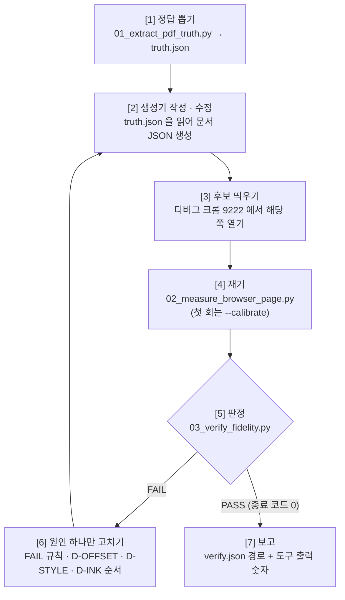

# 📐 External PM Visual Fidelity Replicator

이 스킬은 **원본 PDF 한 쪽 → 브라우저 편집기 페이지**를 "보기에 비슷하게"가 아니라 **좌표가 같게** 옮기는 작업자 워크플로우입니다.

스크린샷을 번갈아 보며 여백을 1px씩 손으로 고치는 방식은 끝나지 않습니다. 어디가 몇 px 틀렸는지 모르고, 고친 곳이 다른 곳을 밀어내기 때문입니다.
이 스킬은 **정답 좌표를 PDF 에서 뽑고, 브라우저에서 같은 것을 재고, 기계가 판정**하게 합니다.
그래서 같은 절차를 따르면 다른 에이전트도 같은 결과를 냅니다.

* **도구**: [`.agents/tools/visual_fidelity/`](../../tools/visual_fidelity/README.md) (`01` 정답 뽑기 · `02` 브라우저 재기 · `03` 판정)
* **정답 예시**: [`examples/atticus_result.md`](./examples/atticus_result.md) — Atticus 청구서, 33/33 글자 ±1px, 평균 오차 0.11px (2026-10-29)
* **생성기 예시**: [`examples/atticus_vdoc_adapter.py`](./examples/atticus_vdoc_adapter.py) — VibeDocStudio `.vdoc` 쪽을 만드는 어댑터
* **자주 틀리는 것**: [`references/lessons_learned.md`](./references/lessons_learned.md) — **작업 전에 반드시 읽습니다.**
* **CLI 루프**: [`references/cli_loop_guide.md`](./references/cli_loop_guide.md) — agy CLI 에이전트가 도구(`evaluate` · `set_plan` · `update_tune` …)로 같은 절차를 도는 법. 생성기는 `apps/api/app/catalog/agents/fidelity_layout.py`, 진단 · 처방은 `fidelity_diagnosis.py`

---

## 🎯 1. 발동 시점 (Triggers)

* "이 PDF 랑 똑같이 만들어줘", "원본이랑 차이가 있어", "99% 이상 유사하게", "픽셀 단위로 맞춰"
* 카탈로그 문서(`catalog/<id>/document.json`)의 한 쪽을 원본 PDF 에 맞춰 다시 만들 때
* 편집기 엔진(서식 확장 · 쪽 레이아웃)을 고친 뒤 **기존 쪽이 원본에서 벗어나지 않았는지** 다시 확인할 때 (회귀 검사)

발동하지 않는 경우: 원본 PDF 가 없는 "느낌만 비슷하게" 디자인 작업. 정답 좌표가 없으면 이 스킬은 할 일이 없습니다.

---

## 📂 2. 대상 경로 & 도구

| 무엇 | 경로 · 명령 |
| :--- | :--- |
| 원본 (정답) | 원본 **PDF** 파일 한 쪽. 예: `workbench/05.llm_tuning/01.outline_extraction_v2/01.dataset/raw/Atticus_LLC_Invoice_000081709.pdf` |
| 작업 폴더 | `work/fidelity/<문서 id>/` — `truth.json` · `measure.json` · `candidate.png` · `verify.json` · `diff.png` 가 모두 여기에 모입니다 |
| 후보 페이지 | 디버그 크롬(`--remote-debugging-port=9222`, 프로필 `C:\chrome-rea-debug`)에 띄운 편집기 탭. 예: VibeDocStudio `http://localhost:5180` |
| 생성기 | 문서 JSON 을 **만들어 내는 스크립트** (예: `examples/atticus_vdoc_adapter.py`). 문서 JSON 을 손으로 고치지 않습니다 |
| 글꼴 | 원본 PDF 글꼴의 **공식 배포본 전체 글꼴**(.ttf). 편집기에 `@font-face` 로 싣고, `01 --font` 에도 같은 파일을 줍니다 |
| 도구 | `python .agents/tools/visual_fidelity/01_extract_pdf_truth.py` · `02_measure_browser_page.py` · `03_verify_fidelity.py` |

---

## 🚫 3. 절대 규칙 (위반 시 산출물 폐기)

1. **정답은 원본 PDF 하나입니다.** 같은 문서를 다시 조판한 `.typ` · `.docx`, 다른 PC 에서 다시 컴파일한 PDF, 스크린샷은 정답이 아닙니다. 글꼴이 바뀌어 있을 수 있습니다 (`L-01`).
2. **눈으로 판정하지 않습니다.** "나란히 놓고 보니 같다"는 근거가 아닙니다. 스크린샷 · `diff.png` 는 **어디를 볼지 찾는 진단용**입니다 (`L-12`).
3. **문서 JSON 좌표를 손으로 고치지 않습니다.** 생성기가 `truth.json` 을 읽어 만들고, 틀리면 **생성기를 고쳐 다시 만듭니다.** 손으로 고친 1px 은 다음 생성 때 사라지고, 다른 쪽에는 옮겨지지 않습니다.
4. **완료는 `03` 이 정합니다.** `VERDICT: PASS` 와 종료 코드 0, 그리고 `verify.json` 경로가 있어야 "완료"라고 씁니다. `거의 동일` · `99% 일치` · `완벽` 같은 자기 인증 문구는 쓰지 않습니다. 보고하는 숫자는 **도구 출력에 찍힌 숫자만** 옮깁니다.
5. **허용 오차를 늘려 통과시키지 않습니다.** `--tol-pos` · `--pix-margin` 등 기본값을 바꾸려면 사용자에게 까닭을 말하고 승인을 받습니다. 바꿨다면 보고에 바꾼 값을 적습니다.
6. **편집 중인 문서 탭을 새로고침하지 않습니다.** `02 --reload` 는 저장된 상태의 탭에서만 씁니다 (떠나기 확인 창이 뜨면 탭이 멈춥니다).
7. **잡음 하한선 위로는 올라갈 수 없습니다.** 같은 PDF 를 두 렌더러(MuPDF · PDFium)로 그린 차이가 상한입니다. 하한선에 닿았는데 더 올리려고 글자를 비틀지 않습니다 (`L-11`).
8. **이 파이프라인의 정체성은 문서 서식입니다.** 산출물 · 보고에 웹소설 · 소설 도메인 용어를 섞지 않습니다.

---

## 🧮 4. 조판 공식 — 브라우저를 PDF 처럼 줄 세우기

PDF 는 글자마다 좌표가 박혀 있고, 브라우저는 줄 상자를 쌓아 글자를 흘립니다. 둘을 같게 만드는 공식은 아래가 전부입니다.
값은 모두 `truth.json` 에서 나옵니다. **추측한 상수를 쓰지 않습니다.**

| 무엇 | 공식 · 설정 | 근거 |
| :--- | :--- | :--- |
| 단위 | `px = pt × 96 / 72` (쪽 왼쪽 위 원점) | 01 · 02 모두 이 단위 |
| 줄 높이 | `line-height = 글자px × F`, `F = (ascent + descent) / UPM` (`truth.json` 의 `fonts.*.content_height`, DejaVu Sans = 1.1641) | 이때 글자 상자 위쪽 = 줄 상자 위쪽 → PDF 글자 `y` 가 곧 줄 위치 |
| 줄 간격 | `margin-top = 이번 줄 y − (앞줄 y + 앞줄 글자px × F)` | 간격을 짐작하지 않고 PDF 에서 뺀다 |
| 문단 글자 크기 | 문단(`p`) 자신의 `font-size` 를 그 줄 글자와 같게 | 문단 기본 크기가 더 크면 strut 이 줄을 키운다 (`L-04`) |
| 크기별 오프셋 | `02 --calibrate` 로 잰 "글자 상자 − 줄 상자" 값을 줄 위치에서 뺀다 (Atticus: 9.6pt · 8pt 에서 −1px) | 크롬은 크기에 따라 글자 상자를 정수 px 로 반올림한다 (`L-05`) |
| 자간 | 단어 · 공백 토큰마다 `letter-spacing` = `truth.json` 의 `spans[].tokens[].ls` | PDF 는 글자 위치를 직접 박는다. 진행폭과의 차를 토큰별로 푼 값 |
| 커닝 · 합자 | `font-kerning: none` · `font-variant-ligatures: none` | PDF 글자 위치는 이미 커닝이 반영돼 있다 (`L-06`) |
| 블록 바운더리 | 문서 본문 블록은 본문 컬럼 폭(frame `x = margin_left`, `w = content_width`)을 공통 유지한다. 중앙/우측 정렬은 블록을 이동시키지 않고 내부 `text-align: center/right` 로 처리한다. `frame.x + frame.w <= page.width` 엄격 준수 (`F-BLOCK-001`) | 블록 시작점을 글자 위치로 밀거나 임의 폭을 주면 블록 선택 바운더리가 종이 밖으로 탈출한다 (`L-15`) |
| 쪽 테두리 | `border` 대신 `ring`/`outline`/`box-shadow` | border 는 안쪽 좌표를 1px 밀어낸다 (`L-13`) |
| 편집기 최소 높이 | 정밀 모드에서 편집 영역 `min-height: 0` | 빈 줄 최소 높이가 표 행을 키운다 (`L-07`) |
| 글꼴 | 공식 배포본 전체 글꼴을 `@font-face` 로 | PDF 에서 뽑은 부분 글꼴은 cmap 이 없어 브라우저가 못 쓴다 (`L-03`) |

---

## 📋 5. 실행 7단계



### [Step 1] 정답 뽑기

```bash
python .agents/tools/visual_fidelity/01_extract_pdf_truth.py --pdf "<원본.pdf>" --page 1 --out-dir work/fidelity/<id> \
  --font DejaVuSans=<경로>/DejaVuSans.ttf --font DejaVuSans-Bold=<경로>/DejaVuSans-Bold.ttf
```

* 출력의 `PDF 글꼴` 줄을 보고 **같은 글꼴 파일을 구해** `--font` 로 묶습니다. 이름이 안 맞으면 `[WARN] --font 에 없는 PDF 글꼴` 이 나옵니다.
* `F(...)` 줄이 줄 높이 공식의 F 입니다. `잡음 하한선` 줄이 이 쪽에서 도달할 수 있는 최대 픽셀 일치도입니다.

### [Step 2] 생성기 작성 · 수정

* `truth.json` 의 `spans` 를 블록(머리글 · 주소 · 표 · 바닥글 …)으로 묶고, §4 공식으로 문서 JSON 을 만듭니다.
* 생성기는 **보정값 파일**(`tune.json`: 크기별 오프셋 등)을 따로 읽게 만듭니다. 보정은 생성기 코드가 아니라 이 파일에 쌓습니다.
* 편집기가 서식을 지우는지 먼저 확인합니다. Tiptap 은 스키마에 없는 `class` · `style` 을 조용히 버립니다 (`L-02`). 필요한 스타일은 편집기 확장으로 받아야 합니다.

### [Step 3] 후보 띄우기

* 편집기에서 해당 쪽을 엽니다. 쪽 요소를 집어낼 **CSS 선택자**와 그 쪽에만 있는 **글자**를 정해 둡니다 (예: `main section > div.bg-white` + `SEO MINGYU`).

### [Step 4] 재기

```bash
python .agents/tools/visual_fidelity/02_measure_browser_page.py --truth work/fidelity/<id>/truth.json --out-dir work/fidelity/<id> \
  --target-url-contains localhost:5180 --page-selector "<쪽 선택자>" --page-text "<쪽 고유 글자>" \
  --hide-selector "<쪽 선택자> button" --calibrate
```

* `[WARN] 사진에 찍힌 편집 도구 모양` 이 나오면 `--hide-selector` 를 더 줘서 다시 잽니다 (`03` 이 `F-CHROME-001` 로 막습니다).
* `calibrate` 줄의 크기별 오프셋을 `tune.json` 에 옮기고 생성기를 다시 돌립니다. **처음 한 번만** 하면 됩니다.

### [Step 5] 판정

```bash
python .agents/tools/visual_fidelity/03_verify_fidelity.py --truth work/fidelity/<id>/truth.json --measure work/fidelity/<id>/measure.json \
  --json work/fidelity/<id>/verify.json --diff work/fidelity/<id>/diff.png
```

### [Step 6] 원인 하나만 고치기

한 번에 **한 가지 원인만** 고치고 Step 4 부터 다시 잽니다. 여러 개를 같이 고치면 어느 것이 효과였는지 모릅니다. 고치는 순서:

1. **구조** — `F-ELEM-001`(글자 없음) · `F-FONT-001`(대체 글꼴) · `F-SIZE-001`(크기) · `D-STYLE`(서식 소실). 이게 남아 있으면 위치를 맞춰도 의미가 없습니다.
2. **줄바꿈** — `F-WRAP-001`. 블록 폭 · 자간 토큰 · 끝 공백을 봅니다.
3. **크기별 일괄 오프셋** — `D-OFFSET` 이 제안한 값(`verify.json` 의 `offset_suggestions_px`)을 `tune.json` 에 넣습니다.
4. **개별 위치** — 남은 `F-POS-001`. 같은 글자열이 두 군데면 짝짓기가 바뀌었는지 `measure.json` 의 `candidates_per_span` 을 봅니다 (`L-08`).
5. **픽셀** — `F-PIX-001`. `--diff` 그림에서 빨강(원본에만) · 파랑(후보에만)이 **위치가 다른 모양**인지 **같은 모양의 두께 차**인지 봅니다. 두께 차뿐이면 렌더러 몫입니다 (`L-11`).

**멈추는 조건**: `VERDICT: PASS`. 또는 남은 것이 WARN 뿐이고 각 WARN 의 원인이 브라우저 한계(테두리 정수 px 등, `L-10`)임을 설명할 수 있을 때.

### [Step 7] 보고

§7 형식으로 씁니다. `03` 출력의 숫자를 그대로 옮기고, 남은 WARN 과 그 까닭을 적습니다.

---

## 🔒 6. 프로그램으로 강제하기 (선택 — 설치는 사용자 승인 후)

말로 된 규칙은 에이전트가 건너뛸 수 있습니다. 확실히 하려면 **작업을 끝내려는 순간 판정 도구가 돌게** 합니다.

* **Claude Code** — 대상 프로젝트 `.claude/settings.json` 의 `Stop` 훅. 종료 코드 2 는 "끝내지 못함"으로 돌려보내고 stderr 를 에이전트에게 보여 줍니다.

```json
{
  "hooks": {
    "Stop": [{ "hooks": [{ "type": "command",
      "command": "python .agents/tools/visual_fidelity/02_measure_browser_page.py --truth work/fidelity/<id>/truth.json --out-dir work/fidelity/<id> --target-url-contains localhost:5180 --page-selector \"<쪽 선택자>\" --page-text \"<쪽 고유 글자>\" >&2 && python .agents/tools/visual_fidelity/03_verify_fidelity.py --truth work/fidelity/<id>/truth.json --measure work/fidelity/<id>/measure.json >&2 || exit 2"
    }]}]
  }
}
```

* **다른 에이전트(Antigravity · Codex 등)** — 작업 지시서 마지막 줄에 위 `02 && 03` 명령을 넣고 "종료 코드 0 의 출력 전체를 붙여야 완료"라고 적습니다.
* **CI** — 같은 명령을 헤드리스 크롬으로 돌리면 편집기 변경이 기존 쪽을 망가뜨렸는지 PR 마다 잡을 수 있습니다.

훅은 `02` 부터 다시 돌립니다. `03` 만 돌리면 예전 `measure.json` 으로 통과할 수 있기 때문입니다.

---

## 🧾 7. 보고 형식

```markdown
### 시각 일치도 — <문서 id> p.<쪽> (원본: <PDF 파일 이름>)
- 판정: `VERDICT: PASS` (FAIL 0 · WARN n) — `work/fidelity/<id>/verify.json`
- 글자 위치: <a>/<b> 개 ±1.0px 이내, 평균 |dx| · |dx1| · |dy| = <…>, 최대 <…>px
- 픽셀: ink F1@1px <…>% (잡음 하한선 <…>%)
- 남은 WARN: <규칙 ID> — <까닭> (예: F-RULE-001 2.4px 선이 2px 로 그려짐 — 크롬이 테두리를 정수 px 로 내림)
- 바꾼 것: <생성기 · 편집기 엔진 · tune.json 변경 요약>
- 기본값과 다르게 쓴 옵션: <없음 | --tol-pos 1.5 (사용자 승인, 까닭)>
```

---

## 🧠 8. 가드레일 (Guardrails)

* **숫자가 먼저, 그림은 나중.** 그림을 먼저 보면 "거의 같다"에서 멈춥니다. `03` 이 어디가 몇 px 인지 알려 준 뒤에 그 자리만 확대해 봅니다.
* **한 번에 하나.** 원인 하나 → 다시 재기. 오프셋 · 자간 · 폭을 한꺼번에 바꾸지 않습니다.
* **평균만 보지 않습니다.** 평균 0.1px 이어도 한 덩어리가 5px 틀리면 FAIL 입니다. `03` 은 덩어리마다 판정합니다.
* **편집기 엔진을 고쳐야 할 때가 있습니다.** 서식이 저장되지 않거나(`L-02`), 최소 높이 · strut 이 끼어들면(`L-04`, `L-07`) 생성기로는 못 맞춥니다. 편집기 확장을 고치고, **다른 카탈로그 쪽이 망가지지 않았는지** 함께 확인합니다.
* **블록 바운더리는 종이 안에.** 텍스트 위치만 맞추기 위해 블록의 `x`나 `w`를 임의로 늘려 종이 밖으로 밀어내지 않습니다. `frame.x + frame.w <= page.width`는 `03`의 `F-BLOCK-001` 규칙으로 차단됩니다.
* **새 함정을 만나면 기록합니다.** 두 번째로 같은 함정에 걸리면 `references/lessons_learned.md` 에 올리고, 기계로 잡을 수 있으면 `03` 규칙으로 만듭니다.
