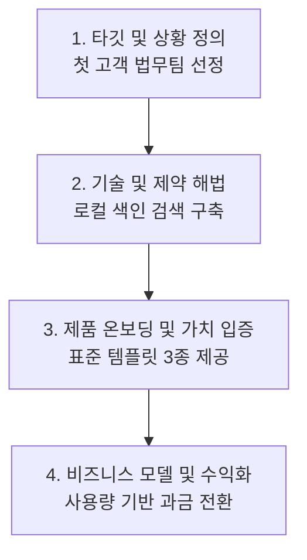

# 작업대 평가 — wb-baseline

전체 23/25 · 튜닝 세트 23/25 · 보류 세트 0/0

| 시나리오 | 영역 | 통과 | 점수 | 시간 | 입력/캐시/출력 | 도구 | 후보 |
|---|---|---|---|---|---|---|---|
| R6-conflict | R | ✅ | 4/4 | 36.7s | 31,651/78,339/2,488 | 8 | - |
| R7-gap | R | ✅ | 2/2 | 33.3s | 25,817/38,669/2,923 | 7 | - |
| F1-decompose | F | ✅ | 3/4 | 34.6s | 25,296/37,055/2,689 | 3 | - |
| F2-compare | F | ✅ | 2/2 | 28.1s | 25,539/36,160/2,127 | 3 | - |
| F4-pin | F | ✅ | 2/2 | 21.3s | 22,285/17,998/1,761 | 2 | - |
| F5-fit | F | ❌ | 2/3 | 25.7s | 22,321/18,078/1,802 | 1 | - |
| E1-scan | E | ✅ | 3/3 | 52.8s | 35,004/117,222/2,961 | 6 | - |
| E2-trim | E | ✅ | 3/3 | 71.5s | 37,955/162,365/5,785 | 8 | ready:2,needs_fix:2,ready:2 |
| E3-restore | E | ✅ | 4/4 | 20.4s | 28,200/57,002/1,156 | 3 | ready:1 |
| E5-consistency | E | ✅ | 4/4 | 32.6s | 34,244/115,975/1,642 | 6 | - |
| E6-todo | E | ✅ | 3/3 | 32.8s | 22,278/18,001/1,042 | 1 | - |
| RE1-fill | RE | ✅ | 3/3 | 94.0s | 55,185/274,985/5,997 | 12 | ready:3 |
| RE2-verify | RE | ✅ | 3/3 | 94.1s | 56,248/349,115/4,476 | 16 | - |
| RE3-update | RE | ✅ | 3/3 | 72.2s | 44,713/214,154/5,776 | 12 | ready:2 |
| FE1-genre-only | FE | ✅ | 5/5 | 32.6s | 28,040/58,929/2,356 | 5 | ready:2,ready:2 |
| FE2-three | FE | ✅ | 5/5 | 51.1s | 30,299/86,122/4,302 | 12 | ready:3 |
| FE3-toggle | FE | ✅ | 3/3 | 80.8s | 36,392/134,598/6,735 | 7 | ready:2,ready:2,ready:2 |
| FE4-gap | FE | ✅ | 2/2 | 31.2s | 27,977/56,423/2,660 | 3 | - |
| FE5-template | FE | ✅ | 3/3 | 85.1s | 46,370/213,601/7,965 | 11 | ready:2,ready:2 |
| RF1-frame | RF | ✅ | 3/3 | 61.1s | 36,927/137,139/4,865 | 11 | - |
| RF2-proof | RF | ❌ | 1/2 | 29.5s | 30,097/58,632/2,016 | 8 | - |
| RFE1-draft | RFE | ✅ | 4/4 | 83.3s | 44,200/215,715/8,081 | 16 | ready:2,ready:2 |
| RFE-P-three | RFE | ✅ | 6/6 | 89.7s | 43,298/159,501/8,957 | 15 | ready:3 |
| RFE3-swap | RFE | ✅ | 4/4 | 63.7s | 42,904/174,860/4,898 | 11 | ready:2,ready:2,ready:2 |
| RFEH-restore-restyle | RFE | ✅ | 5/5 | 62.2s | 40,732/159,243/4,922 | 7 | ready:1,ready:2 |

## R6-conflict — R
> 리서치 자료끼리 서로 충돌하는 수치가 있어? 있으면 어느 쪽을 믿어야 해?

- ✅ 충돌값 1,200: 있음
- ✅ 충돌값 1,450: 있음
- ✅ 어느 쪽이 맞는지 근거: 있음
- ✅ 지표 파일 읽음: 1건

**도구**: ws_tree → read_file → read_file → read_file → read_file → read_file → read_file → ws_coverage

**읽은 원천**: 2025-02-03_인터뷰_A사.md, 2025-03-10_인터뷰_B사.md, 2025-03_지표_요약.md, README.md, 경쟁사_비교.md, 보고서_요약_원래본.md

생각

I'm thinking through how to approach this.

Analyzing each file using a detailed read operation. The goal is to fully understand the content of these six small files, totaling 42 lines. Examining the first file: `archive/보고서_요약_원래본.md`.

WAU discrepancy noted between the interview and the 3-week product log data. The interview reports 1200 WAU as of February, while March's 3-week product log data shows 1450.

The 1450 WAU figure from the March product log data is deemed more reliable than the 1200 WAU figure from the February interview. This is because the former is a direct, objective measurement from the product logs, while the latter is an estimated value. Additionally, the March data is more recent, and the March report explicitly clarifies the 1200 WAU figure's estimated nature. Other metrics, such as annual user growth and template usage, are not directly comparable.

**답변**

리서치 자료 간에 **주간 활성 사용자(WAU)** 수치에서 충돌이 확인됩니다.

---

### 1. 충돌하는 수치 내역

* **1,200명**: [A사 인터뷰](vdoc:resource/file_424d917afe) (L7)
  > "주간 활성 사용자(WAU)는 1,200명이라고 들었다 (2월 기준, 담당자 구두)."
* **1,450명**: [3월 지표 요약](vdoc:resource/file_ca01d6d352) (L9, L13)
  > "WAU: 1,450명"  
  > "※ WAU 는 제품 로그 기준(3월 3주). 2월 인터뷰의 1,200명은 구두 추정치다."

---

### 2. 신뢰해야 하는 쪽과 판단 근거

**[3월 지표 요약](vdoc:resource/file_ca01d6d352)의 `1,450명`을 신뢰해야 합니다.**

1. **데이터 신뢰도(로그 기반 vs 구두 추정)**:  
   1,200명은 2월 인터뷰 당시 담당자의 구두 전달 추정치인 반면, 1,450명은 시스템의 **실제 제품 로그를 바탕으로 집계된 객관적 데이터**입니다.
2. **시점의 최신성**:  
   [A사 인터뷰](vdoc:resource/file_424d917afe) (L3)는 2025년 2월 기준 데이터이며, [3월 지표 요약](vdoc:resource/file_ca01d6d352) (L3)은 2025년 3월 21일 기준 최신 지표입니다.
3. **명시적 정정 명기**:  
   [3월 지표 요약](vdoc:resource/file_ca01d6d352) (L13) 주석에서 2월 인터뷰 언급 수치(1,200명)가 구두 추정치였음을 명확히 짚고 정정하고 있습니다.

## R7-gap — R
> 이 리서치 자료로 매출까지 포함한 분기 사업 보고서를 쓰려면 뭐가 빠졌어?

- ✅ 매출 데이터 없음: 있음
- ✅ 있는 데이터 제시: 있음

**도구**: ws_tree → read_file → read_file → read_file → read_file → read_file → read_file

**읽은 원천**: 2025-02-03_인터뷰_A사.md, 2025-03-10_인터뷰_B사.md, 2025-03_지표_요약.md, README.md, 경쟁사_비교.md, 보고서_요약_원래본.md

생각

Initial assessment: The provided files are small, requiring a thorough review to understand the contained information. The listed paths indicate a focus on research, likely metrics, and documentation related to a "vault_beta" project within a larger "VibeDocStudio" application. This suggests the need to understand the relationship between the documentation and the metrics in the broader research context.

Observed WAU of 1,450 users based on product logs from the third week of March, alongside a 68% template usage rate. First document completion averaged 31 minutes. The analysis also reviewed competitive feature comparisons with N and M companies, and customer feedback from A company interviews.

Missing data includes crucial financial metrics such as quarterly revenue, user segmentation by payment plan, revenue growth against targets, and profitability details like operating costs and margins. Also absent are time-series product performance metrics.

**답변**

현재 마운트된 리서치 자료(총 6개 파일)를 모두 검토한 결과, **매출을 포함한 분기 사업 보고서**를 완성하기 위해 필요한 핵심 정보들이 다수 결손되어 있습니다.

---

### 1. 현재 자료에서 확보 가능한 내용
- **프로덕트 사용 지표 (단일 시점)**: 3월 3주차 기준 WAU 1,450명, 템플릿 사용률 68%, 첫 문서 완성 평균 31분 ([2025-03 지표 요약](vdoc:resource/file_ca01d6d352) L7-13)
- **고객 정성 피드백**: 의사결정 추적 불편 해소 니즈 및 보안 요구사항 ([A사 인터뷰](vdoc:resource/file_424d917afe) L5-9, [B사 인터뷰](vdoc:resource/file_698d94bf09) L5-8)
- **시장/경쟁 현황 메모**: 경쟁사(N사, M사)의 기능적 한계 메모 ([경쟁사 비교 메모](vdoc:resource/file_506aab9539) L1-4)
- **과거 벤치마크**: 작년 연간 사용자 성장률 210% ([보고서 요약 원래본](vdoc:resource/file_62220c4596) L3)

---

### 2. 분기 사업 보고서 작성을 위해 빠진 핵심 항목

#### ① 재무 및 매출 지표 (완전 부재)
*현재 리소스에는 금액 관련 데이터가 전혀 없습니다.*
- **분기 실적 및 성장률**: 분기 총 매출액, MRR/ARR, 전분기(QoQ) 및 전년 동기(YoY) 대비 매출 성장률
- **수익화/단가 지표**: 유료 고객 수(Paid Accounts), 요금제별 비중, ARPU(고객당 평균 매출), 결제 전환율
- **목표 달성률**: 분기 목표 매출 대비 달성률(Target vs. Actual)
- **비용 및 손익**: 주요 지출(인프라 비용, 마케팅/영업비) 및 영업이익/손익 분기 분석

#### ② 분기 전체 시계열 지표 (연속성 부족)
- [2025-03 지표 요약](vdoc:resource/file_ca01d6d352)에는 **3월 3주차 특정 시점의 단편적 수치**만 기재되어 있습니다.
- 분기 전체를 아우르는 **1월·2월·3월 월별 추이(MAU/WAU 추이, 코호트 유지율/이탈률, 신규 유입 수)**가 필요합니다.

#### ③ B2B 영업 및 세일즈 파이프라인
- [A사](vdoc:resource/file_424d917afe)와 [B사](vdoc:resource/file_698d94bf09) 인터뷰 내용만으로는 사업적 성과 측정이 어렵습니다.
- 리드 인입 수, PoC(개념검증) 진행 건수, 실제 계약 전환율, 계약 규모(ACV) 등 세일즈 딜 현황이 빠져 있습니다.

#### ④ 다음 분기 계획 및 실행 로드맵
- 당 분기 주요 마일스톤 달성 평가, 향후 제품 출시 일정, 다음 분기 매출 및 지표 목표치가 부재합니다.

---

> **권장 보완 자료**: 재무 관리 툴 또는 결제 대시보드에서 추출한 **분기 매출 결산 데이터(MRR, 요금제별 결제액)**와 **1~3월 월별 유저 트렌드 리포트**를 추가 리소스로 마운트해 주시면 정밀한 분기 보고서 작성이 가능합니다.

## F1-decompose — F
> 이 레퍼런스를 층위별로 분해해줘. 내가 뭘 가져다 쓸 수 있는지.

- ✅ 레퍼런스 읽기 · 측정: wb_patterns, wb_read
- ✅ 층위 5개 이상: 5/5 (정보 밀도|스캐너, 증명|근거, 프레임|논증|SCQA|상황, 조판|타이포|제목 계층, 장르|어조|종결)
- ✅ 측정값 근거: 있음
- ❌ (가점) 레퍼런스 고유 수치 미전달: 없음

**도구**: wb_outline → wb_patterns → wb_read

**읽은 원천**: 없음

생각

I'm thinking through how to approach this.

Examined the provided references, identifying key patterns. Re-evaluating the assigned roles and the operational rules to ensure alignment: `Reference = Pattern Analysis Target, Editor = None, Resource = None, Output = Layered Decomposition Report`. The focus is on abstracting decision trajectories (patterns), not directly incorporating sentences, proper nouns, or numerical data from the references into the report. Decision-making will be based on measurements and will involve a layered decomposition.

Delineating patterns for user application, specifically what to incorporate versus exclude (numerical data, proper nouns). Pattern presentation will utilize a link format: \[human-readable name](vdoc:type/id). The structure organizes references like \[(주)루미나랩스 시리즈A 투자 제안서](vdoc:doc/vdoc_eval_ref_invest).

Further decomposition includes a D4 framework focusing on an argument structure: a conclusion-first approach. This framework employs an SCQA (Situation, Complication, Question, Answer) structure ([논리](vdoc:slot/a_scqa)) to structure persuasive flow and mapping of a summary section's structure (Problem-Solution-Evidence-Request) ([요약](vdoc:slot/a_summary)). D1 examines information density, noting concise sentence/paragraph lengths, high compression, focused bold emphasis, and dash-based keyword-explanation mapping. D2 focuses on data presentation, evaluating numerical density and market metrics.

**답변**

레퍼런스=패턴 분석 대상, 에디터=없음, 리소스=없음, 산출=층위별 분해 리포트

---

### [루미나랩스 시리즈A 투자 제안서](vdoc:doc/vdoc_eval_ref_invest) 층위별 패턴 분해

이 레퍼런스는 총 3쪽([Page 1](vdoc:page/ap1)·[Page 2](vdoc:page/ap2)·[Page 3](vdoc:page/ap3))으로 구성된 투자 제안서로, 군더더기 없는 논증 틀과 높은 정보 밀도를 보여줍니다.

---

#### 1. D4 서술 프레임워크 (논증 구조)
* **결론 우선(Conclusion-First)**: [요약](vdoc:slot/a_summary) 시작점에 단정적인 핵심 비전 명제를 볼드로 먼저 선언합니다.
* **4단 요약 프레임**: `문제 — 해법 — 증거 — 요청`의 4단 구조로 전체 제안의 골격을 1페이지 안에 조망합니다.
* **SCQA 논리 전개**: [논리](vdoc:slot/a_scqa)에서 `상황(S) → 문제(C) → 질문(Q) → 해답(A)`의 4단계 헤딩(`H2`)을 배치해 문제 제기부터 솔루션 도출까지의 필연성을 증명합니다.

#### 2. D1 스캐너빌리티 & 정보 밀도
* **초고밀도 압축 문장**: 평균 문장 길이 17.1자, 평균 단락 길이 20.4자(장문 단락 비율 0.0%)로 극단적인 단문 위주 구성입니다.
* **시선 유도 볼드**: 단락 첫머리 키워드와 핵심 결론 문장에만 볼드(단락당 0.38회)를 집중해 훑어보기(Skim reading)만으로 핵심이 파악됩니다.
* **개조식 인라인 매핑**: `- **키워드** — 설명` 형식을 통해 줄바꿈을 아끼면서 가독성을 극대화했습니다.

#### 3. D2 근거 · 데이터 증명 방식
* **높은 수치 밀도**: 100자당 수치 4.03개(`numbers_per_100=4.03`)로, 모든 주장에 정량적 숫자를 결합했습니다.
* **Key-Value 2열 테이블**: 시장 규모(TAM), 고객 지표, 고객 만족도(NPS)를 [시장](vdoc:slot/a_market)에서 2열 표로 정돈하고 하단에 `(출처: ...)`를 달아 신뢰도를 확보했습니다.
* **목표-기간-배분 3박자 요청 공식**: [요청](vdoc:slot/a_ask) 블록에서 `[요청 자금]으로 [기한] 안에 [달성 목표 수치]를 만든다 + 자금 비중(60% : 40%)` 구조를 취했습니다.

#### 4. D6 장르 규약 & 톤앤매너
* **선언적 종결 어미**: 완결형 평서문(`~다`, 50%)과 개조식 명사형 종결(50%)을 교차 사용하여 스타트업 IR/피치 문서 특유의 속도감과 확신에 찬 어조를 유지합니다. 경어체(`~합니다`)는 배제되었습니다.

---

### 내 문서에 가져다 쓸 수 있는 것 vs 버려야 할 것

| 구분 | 가져다 쓸 패턴 (Adopt) | 가져오면 안 되는 것 (Discard) |
| :--- | :--- | :--- |
| **논리 구조** | `결론 선언 → 문제-해법-증거-요청` 4단 요약 구조 | 레퍼런스의 사업 도메인(문서 자동화 등) |
| **전개 방식** | SCQA(상황·문제·질문·해답) 4단계 소제목 전개 | 레퍼런스의 논리 문장 표현 그대로 복사 |
| **지표 표현** | `지표 \| 값` 2열 표 + 하단 출처 표기 조판 형식 | `4.2조원`, `37곳`, `NPS 71` 등의 레퍼런스 수치 |
| **요청 서술** | `[규모]로 [기간] 내 [목표] 달성 + 예산 배분율(A:B)` 공식 | `50억원`, `18개월`, `60%/40%` 등의 구체적 제안 조건 |
| **문체** | 20자 내외 단문, `- **키워드** — 설명` 포맷 | 고유명사((주)루미나랩스 등) |

## F2-compare — F
> 두 레퍼런스 뭐가 달라?

- ✅ 층위 차이 4개 이상: 6/4 (개조식|~함|함\., 결재|문서번호|메타, 결론[^\n]{0,10}(먼저|앞)|두괄, SCQA|상황.{0,6}문제, 볼드|굵, 표)
- ✅ (가점) 측정 도구: wb_compare

**도구**: wb_compare → wb_outline → wb_outline

**읽은 원천**: 없음

생각

Initial suspicion is that the two references address different aspects, given their titles. One appears to be a private investment proposal, and the other a public internal report on standardization. Need to confirm the specific differences by looking at the content of each.

The task is to clearly articulate the differences between two documents, structuring the analysis around six identified dimensions (D1-D6). The links provided establish the references: a Lumina Labs investment proposal and a Korea Data Agency internal report. Focusing on the first dimension (D4), the analysis will address the distinct nature and narrative framework of each document.

**답변**

[루미나랩스 투자 제안서](vdoc:doc/vdoc_eval_ref_invest)와 [회의록 표준화 추진 계획](vdoc:doc/vdoc_eval_ref_public)은 **문서 장르, 서술 프레임워크, 문체 규약** 전반에서 상반된 패턴을 갖고 있습니다.

---

### 1. 서술 프레임워크 (D4)
* **[투자 제안서](vdoc:doc/vdoc_eval_ref_invest)**: **두괄식 피치 구조(SCQA)**
  * 결론(비전)을 서두에 배치(`conclusion_first: true`)하고, **상황 → 문제 → 질문 → 해답** 순으로 청자의 설득을 유도합니다.
* **[내부 보고서](vdoc:doc/vdoc_eval_ref_public)**: **정석 행정 기안 구조**
  * **1. 추진 배경 → 2. 현황 및 문제점 → 3. 개선 방안 → 4. 향후 계획** 순서의 논리적·단계적 전개 방식을 따릅니다.

### 2. 격식 및 메타 규격 (D3 · D5)
* **[투자 제안서](vdoc:doc/vdoc_eval_ref_invest)**: 
  * [표지](vdoc:slot/a_cover) 중심의 피치덱 형태이며, 별도의 문서 통제 규격 없이 텍스트 블록 위주로 구성되어 있습니다.
* **[내부 보고서](vdoc:doc/vdoc_eval_ref_public)**:
  * 공공·기업 행정 양식에 맞춰 [문서 정보](vdoc:slot/g_meta)(문서번호, 보고일자, 보안등급), [결재란](vdoc:slot/g_approval)(담당·검토·승인), [요약 상자](vdoc:slot/g_summary)(Callout)가 표준 블록으로 완비되어 있습니다.

### 3. 문체 및 장르 규약 (D6 · D1)
* **[투자 제안서](vdoc:doc/vdoc_eval_ref_invest)**:
  * 평서문(`~다`)과 명사형 종결을 고루 섞어 쓰고, 질문형 문장(`questions: 1`)과 볼드 강조(`bold_per_para: 0.38`)를 통해 메시지를 강조합니다.
* **[내부 보고서](vdoc:doc/vdoc_eval_ref_public)**:
  * 전형적인 행정 **개조식 종결어미(`~함·~임·~음`)** 중심이며, 불릿 비율이 54%로 높아 감정을 배제한 객관적 보고 문체를 유지합니다.

### 4. 데이터 증명 및 레이아웃 (D2 · D5)
* **[투자 제안서](vdoc:doc/vdoc_eval_ref_invest)**: 지표와 수치 밀도(100자당 4.03개)가 높아 핵심 성장 지표(TAM, 고객사 수, NPS 등)를 전면에 내세웁니다.
* **[내부 보고서](vdoc:doc/vdoc_eval_ref_public)**: 구조화된 표(Table 3개)를 활용해 메타 정보와 실행 계획을 격자형으로 정돈해 전달합니다.

---

> **요약**: 투자 제안서는 **‘설득형 SCQA 스토리텔링과 핵심 지표 강조’**, 내부 보고서는 **‘결재 규격·단계적 기안 프레임워크·개조식 전달’** 패턴이 필요할 때 각각 벤치마킹하기 적합합니다.

## F4-pin — F
> 이 핀 같은 느낌으로 가고 싶어.

- ✅ 핀 읽기: wb_read
- ✅ 핀의 층위 특정: 2/2 (결론[^\n]{0,12}(먼저|앞|맨)|두괄, 숫자|수치|증거)

**도구**: wb_read → wb_patterns

**읽은 원천**: 없음

생각

I'm thinking through how to approach this.

Initial analysis focuses on the pin's content and the observed pattern measurements. The reference aligns with a specific pattern, but there's no active editor and no mounted resource to inspect. The goal is to diagnose the pin pattern and offer a style guide. The pin's anchor points to a summary box, and its structure leads with a conclusion.

The observed pattern utilizes a four-step modular structure: problem definition, solution proposal, supporting evidence with metrics, and a specific call to action. This structure emphasizes concision with an 80% bullet ratio in the second layer. Data density is high, with quantitative indicators per unit of text. The presentation adopts a conclusion-first structure, presenting a problem-solution framework. The style is direct, combining declarative statements with nominal endings for efficient communication. Since the editor lacks an active document or defined writing slot, it's necessary to designate a target for content generation.

**답변**

[요약 상자](vdoc:ref-pin/ref:vdoc_eval_ref_invest#pin:pinA1)의 스타일과 논증 구조를 분석한 결과입니다. 이 핀은 군더더기를 배제하고 핵심만 한눈에 파악되도록 설계된 **피치형 요약 상자 패턴**을 취하고 있습니다.

---

### 층위별 패턴 분석

1. **서술 프레임워크 (D4 — 두괄식 & 4단계 구조)**
   * **결론 우선(Conclusion-First)**: 가장 중요한 핵심 주장/목표 1문장을 첫 머리에 배치.
   * **논증 4단계 전개**: `문제` → `해법` → `증거(트랙션)` → `요청(Action/Ask)` 순으로 개조식 정리.

2. **정보 밀도 및 스캐너빌리티 (D1)**
   * **압축률**: 평균 문장 길이 약 26자, 개조식 비율 80%로 스캔 속도를 극대화.
   * **키워드-설명 분리**: 각 항목 앞머리에 `라벨 — 핵심 설명` 형태로 일관된 대시 구분자 사용.

3. **데이터 증명 방식 (D2)**
   * **높은 수치 밀도**: 100자당 4.4개 수준의 높은 정량 지표 배치.
   * 막연한 형용사 대신 구체적인 숫자(비율, 고객 수, 평가지수, 금액)로 설득력 확보.

4. **격식 및 어조 (D6)**
   * 평서체(`~다`) 및 명사형 종결을 사용하여 객관적이고 단호한 인상을 형성.

---

### 적용 안내
현재 에디터에 열린 문서(또는 지정된 슬롯)와 사실 근거 리소스가 없습니다. 
적용할 **문서 칸(슬롯)**과 **다룰 내용(또는 리소스)**을 지정해 주시면, 위 `[결론 → 문제 → 해법 → 증거 → 요청]` 틀과 압축된 문체로 즉시 후보안을 제안해 드리겠습니다.

## F5-fit — F
> 이 블로그 글을 레퍼런스로 해서 지금 보고서를 다듬으려고 해. 괜찮을까?

- ✅ 장르 불일치 경고: 있음
- ✅ 안 맞는 층위 지목: 있음
- ❌ 쓸 수 있는 층위 제안: 없음

**도구**: wb_compare

**읽은 원천**: 없음

생각

The user wants to refine a report using a blog post as a reference. The report is an internal business document, specifically a draft report on operational improvements for Q1 2025. The blog post is a reference document containing potential patterns to apply.

The document exhibits a formal style typical of internal business reports, characterized by declarative sentence endings and minimal use of emojis or exclamations. The reference text, in contrast, adopts a more conversational tone, employing "해요(~요)" sentence endings and incorporating emojis.

The reference's conversational style, with its use of "해요" sentence endings, emojis, and listicle format, clashes with the formal tone expected in the business report, which employs declarative sentences and a table-centric data presentation style. Directly using the blog post as a template will undermine the report's professional appearance and established structure. Focus should be on abstracting relevant patterns related to information density, proof methods, and argumentation structure from the reference, rather than copying its superficial aspects.

**답변**

**권장하지 않습니다.** 현재 작성 중인 [2025 Q1 온보딩 개선 운영 보고서 (초안)](vdoc:doc/vdoc_eval_report)와 레퍼런스인 [노트몽키 블로그 — 회의록 정리 꿀팁 5가지](vdoc:doc/vdoc_eval_ref_blog)는 **장르 규약(D6)**과 **서술 프레임워크(D4)** 차원에서 직접적인 충돌이 발생합니다.

---

### 층위별 패턴 진단 결과

| 층위 | 보고서 ([doc](vdoc:doc/vdoc_eval_report)) | 블로그 ([ref](vdoc:doc/vdoc_eval_ref_blog)) | 충돌 및 영향 |
| :--- | :--- | :--- | :--- |
| **D6 장르 규약** | `명사형 종결`(8) · `평서(~다)`(6) 이모지 0개 · 느낌표 0개 | `해요(~요)`(6) 이모지 4개 · 느낌표 3개 | 보고서의 신뢰성과 격식이 훼손되고 캐주얼 톤으로 오염될 위험이 큽니다. |
| **D4 서술 프레임워크** | 요약 → 주요 결정 → 지표 → 다음 단계 (4쪽 보고 체계) | 5가지 팁 나열 (리스트형 블로그) | 의사결정 보고 체계가 단순 팁 나열로 변형될 수 있습니다. |
| **D2·D5 데이터 및 조판** | 구조화된 표 2개, 정량 지표 중심 | 표 0개, 단순 텍스트 블록 | 보고서의 핵심인 정량적 근거 제시 구조가 무너질 수 있습니다. |

---

### 제안
- **전체 레퍼런스 적용은 지양**: 보고서 전체의 문체나 레이아웃 레퍼런스로 삼는 것은 적절하지 않습니다.
- **국소적 착안(D1 정보 밀도)**: 블로그의 "결론부터 제시하는 두괄식 전개"나 "단락 길이 축약" 같은 가독성 아이디어 정도만 선별 적용하는 것이 좋습니다.
- **대안**: 사내 분기 운영 보고서, KPI 리뷰, 또는 공식 비즈니스 리뷰 양식의 레퍼런스를 사용하는 것을 권장합니다.

## E1-scan — E
> 이 문서 훑어 읽기 좋은지 봐줘.

- ✅ 요약 칸 지목: 있음
- ✅ 볼드 남발 지적: 있음
- ✅ 수치로 지적: 있음

**도구**: wb_outline → wb_patterns → wb_read → wb_read → wb_read → wb_read

**읽은 원천**: 없음

생각

Editor role identified as the target document, with no external resources or references needed; the output is a diagnosis and feedback for improvement. The initial action is to outline the document's structure.

The analysis indicates no bullet points or callouts are present. Bold text is moderately frequent. The report's structure lacks sub-headings, consisting only of a single top-level heading. Conclusion is not in the beginning. Ending style is assertive.

The summary is excessively long and lacks concise structure, appearing as a single, lengthy sentence. Excessive bolding on descriptive words rather than key data or conclusions detracts from readability. Considering using bullet points or a summary-first structure to improve clarity and focus.

The document's scanability is severely limited. The primary issue is the complete absence of bullet points or any other visual cues to break up long paragraphs, resulting in a low bullet ratio. This structure hinders quick information retrieval and highlights a need for structural improvement.

The summary's length and lack of structure in the main summary require immediate attention, as a single sentence attempts to cover multiple aspects without clear emphasis. Excessive use of bolding throughout the document creates visual noise, distracting from key takeaways. The absence of a conclusion-first structure and hierarchical subheadings hinders understanding and quick information retrieval. A discrepancy exists between the metric table and body text regarding the first document completion time, adding to the structural disorganization.

**답변**

현재 문서는 **훑어 읽기(스캐너빌리티)가 매우 취약한 상태**입니다. 주요 진단 결과와 원인은 다음과 같습니다.

---

### 1. 주요 진단 지표 및 문제점

* **개조식·불릿 구조 부재 (`bullet_ratio = 0.0`)**
  * [요약](vdoc:slot/r_summary): 단 한 문장(253자)에 배경, 다팀 협업, 템플릿 비교, 지표, 향후 과제까지 만연체로 이어져 있어 핵심 메시지가 한눈에 들어오지 않습니다.
  * [지표 주석](vdoc:slot/r_metric_note): 긴 줄글 형태로 작성되어 있으며 분량 제한(80자)을 초과한 134자로 시각적 피로도가 높습니다.

* **무분별한 볼드 강조 (`bold_per_para = 0.53`)로 인한 시선 분산**
  * [요약](vdoc:slot/r_summary) 내에서 `**온보딩**`, `**여러 팀**`, `**대규모**`, `**다양한**`, `**최우선**`, `**강조**` 등 형용사와 일반명사에 볼드가 남발되어 있습니다. 훑어볼 때 정작 중요한 핵심 수치나 결론이 부각되지 않고 시선이 분산됩니다.

* **결론 우선(두괄식) 구조 부재 (`conclusion_first = false`) 및 소제목 계층 결여**
  * 문서 전체에 대제목(H1) 1개만 존재하며, 하위 섹션별 소제목(H2/H3)이 없어 스크롤이나 페이지 전환 시 맥락 파악이 어렵습니다.
  * 핵심 성과(예: 템플릿 도입 효과)가 서두에 드러나지 않고 문장 후반부에 묻혀 있습니다.

* **데이터 불일치 및 미완성 영역으로 인한 인지적 단절**
  * [지표 표](vdoc:slot/r_metric_table)에는 ‘첫 문서 완성 평균’이 **47분**으로 표기되어 있으나, 바로 아래 [지표 해설](vdoc:slot/r_metric_body)에는 **45분**으로 적혀 있어 훑어 읽는 독자에게 혼란을 줍니다.
  * [문서 정보](vdoc:slot/r_meta)와 [다음 결정 · 결정](vdoc:slot/r_dec_next)이 빈칸으로 남아 있어 문서 완성도가 저해됩니다.

---

### 2. 스캐너빌리티 개선을 위한 권장 사항

1. **[요약](vdoc:slot/r_summary) 개조식 전환**: 결론 중심의 2~3개 불릿 포인트로 분리하고, 볼드는 핵심 수치나 핵심 결과에만 제한적으로 적용.
2. **[지표 주석](vdoc:slot/r_metric_note) 분량 압축**: 80자 이내로 핵심 인사이트(신규 전환율 우수, 기존 사용자 온보딩 보완 필요)만 요약.
3. **수치 정합성 일치**: [지표 표](vdoc:slot/r_metric_table)와 [지표 해설](vdoc:slot/r_metric_body)의 완료 시간(47분 vs 45분) 통일.
4. **미완성 슬롯 보완**: [문서 정보](vdoc:slot/r_meta) 작성 및 [다음 결정 · 결정](vdoc:slot/r_dec_next) 슬롯 채우기.

## E2-trim — E
> 이 칸 분량 제한에 맞게 다듬어줘.

- ✅ 후보 제안: ready · 2안 · mode=restyle · 칸=['r_metric_note']
- ✅ 핵심 낱말 유지: 2/2안
- ✅ (가점) 답이 짧다 — 후보는 화면에 (답 516자)

**도구**: wb_read → wb_patterns → wb_outline → wb_history → wb_history → wb_propose → wb_propose → wb_propose

**읽은 원천**: 없음
- 후보 prop_c7462da4ba ready 2안 restyle · 오류 0 · 경고 2
- 후보 prop_23f16bfc3c needs_fix 2안 restyle · 오류 1 · 경고 2
  - ✗ 후보 1 '1안: 원문 어휘 보존형': 칸 r_metric_note 분량 84자 > 제한 80자.
- 후보 prop_c090ec7b97 ready 2안 restyle · 오류 0 · 경고 2

생각

Template usage increased steadily post-launch, especially among new sign-ups choosing meeting note formats. Existing users showed a slower conversion, retaining a habit of starting with blank documents. This difference requires attention in next quarter's onboarding design.

Initial hypothesis: user seeks a concise version of the existing text within the character limit. Will provide multiple options as the number of alternatives wasn't specified. Mode will be restyle, or alternatively, compress. Validation criteria include length, content preservation, reference integrity, and source validation, ensuring the original facts are represented accurately. Sources include "slot:r_metric_note".

New user preference for meeting note templates boosted usage, but conversion among existing users lagged. This gap requires attention in the next onboarding design iteration. The provided text format is either pure text or wrapped in HTML `
` tags.

Initial focus is on shortening the provided text within the character limit by restyling or compressing. Validation involves checking length, content preservation, reference accuracy, and source integrity based on "slot:r_metric_note". The input is either pure text or HTML `
` tags.

Two candidate summaries are constructed: a concise report-style summary highlighting user differences and an action-oriented plain language summary. Both are intended to address the length constraints and retain the core information from the source.

△ Candidate 1 ("Key Contrast"): "restyle" observed; only 18% of original words remain in r_metric_note (significant content shift?).
△ Candidate 2 ("Flow Summary"): "restyle" observed; only 30% of original words remain in r_metric_note (potential content shift?).

Template usage increased, but focused on new user preferences for meeting notes, while existing users' habits slowed conversion. This difference requires attention in next quarter's onboarding design.

The candidate text length was initially computed as 84 characters, potentially including HTML tags or extra spaces. Recalculating the character count is needed. The target phrase is: "신규 가입자의 회의록 양식 선택".

The text length check confirms the original count of 84 characters. The goal is to reduce this to under 80 characters, specifically aiming for 70-75 characters (including spaces). The original text is too long (134 characters) and needs significant condensation while retaining core meaning. Initial attempt prioritized retaining ori

**답변**

[지표 주석](vdoc:slot/r_metric_note) 칸의 분량 초과(134자 / 제한 80자)를 해소하기 위해 80자 이하로 압축한 2개 안을 제안했습니다.

### 제안된 후보 및 선택 기준

1. **[1안: 원문 핵심 어휘 보존형](vdoc:slot/r_metric_note)** (75자)
   - **특징**: 원문의 핵심 맥락(신규 가입자의 회의록 선택, 기존 사용자 전환 지연, 차기 온보딩 설계 반영)과 어휘를 최대한 보존했습니다.
   - **추천**: 원본의 구체적인 행동 분석 내용과 어조를 그대로 유지하고자 할 때 적합합니다.

2. **[2안: 인과 중심 간결형](vdoc:slot/r_metric_note)** (63자)
   - **특징**: '첫 화면 노출' 인과와 전환 문제를 압축하여 여유 있는 분량으로 명료하게 정리했습니다.
   - **추천**: 주석의 가독성을 높이고 시각적 여백을 더 확보하고자 할 때 적합합니다.

화면의 미리보기에서 적절한 안을 확인하신 후 선택해 주세요.

## E3-restore — E
> 원래 본문으로 되돌려줘.

- ✅ 후보 제안: ready · 1안 · mode=restore · 칸=['r_summary']
- ✅ 처음 글 그대로: 1/1안
- ✅ 리소스 탐색 0회: 없음
- ✅ 이력 사용: wb_history, wb_read

**도구**: wb_history → wb_read → wb_propose

**읽은 원천**: 없음
- 후보 prop_a96bf7eebb ready 1안 restore · 오류 0 · 경고 0

생각

I'm thinking through how to approach this.

**답변**

[요약](vdoc:slot/r_summary) 칸을 rev:3 변경 이전의 원본 상태([초기 원본](vdoc:slot/r_summary))로 되돌리는 복원안을 제안했습니다.

### 제안 후보
- **1안 (원래 본문 복원)**: 초기 원본 내용(`Q1 온보딩 개선의 핵심은 템플릿 우선 제공이다. 첫 문서 완성 시간은 기준선 47분에서 크게 줄었다.`)으로 복구합니다.

화면의 미리보기에서 변경 사항을 확인하신 후 적용 여부를 선택해 주세요.

## E5-consistency — E
> 문서 안에서 서로 어긋난 숫자 있어?

- ✅ 47분: 있음
- ✅ 45분: 있음
- ✅ 표 칸 위치: 있음
- ✅ 해설 칸 위치: 있음

**도구**: wb_outline → wb_read → wb_read → wb_read → wb_history → wb_read

**읽은 원천**: 없음

생각

Initial assessment: The task is to identify conflicting numbers within a document. The absence of mounted resources suggests data resides within the current context. Analyzing the document for numerical inconsistencies is the core objective.

The initial summary indicated a baseline completion time of 47 minutes. However, the subsequent document and metric data show an average completion time of 45 minutes. This represents a reduction in the initial completion time, though the precise reduction amount is not detailed.

The analysis reveals a discrepancy in the reported average first document completion time: 47 minutes in the metrics table versus 45 minutes in the metrics body. The summary also references 47 minutes as the baseline, suggesting the table may be misrepresenting the baseline value as the average. Other numbers such as template usage, number of participants, and the quarter are consistent across the different sections. The conflict centers solely on the average completion time.

**답변**

문서 안에서 **첫 문서 완성 시간** 수치가 서로 어긋나 있습니다.

### 어긋난 숫자 확인

* **[지표 표](vdoc:slot/r_metric_table) (p3)**: 첫 문서 완성 평균 **47분**
* **[지표 해설](vdoc:slot/r_metric_body) (p3)**: 측정 결과 첫 문서 완성까지 평균 **45분**

### 세부 맥락
* [요약](vdoc:slot/r_summary) (p1)에서는 **47분**을 *'기준선으로 삼은 첫 문서 완성 시간'*으로 언급하고 있습니다.
* 반면 [지표 표](vdoc:slot/r_metric_table)에서는 기준선인 47분이 측정 결과 평균으로 기재되어 있어, 해설의 측정 결과(**45분**)와 표의 수치(**47분**)가 일치하지 않는 상태입니다.

## E6-todo — E
> 아직 할 일 남은 칸 알려줘.

- ✅ 빈 칸: 있음
- ✅ 분량 초과 칸: 있음
- ✅ 근거 없는 칸: 있음

**도구**: wb_outline

**읽은 원천**: 없음

생각

The outline is complete. Now, identifying the actionable items within it: two slots are empty—"Document Information" and "Next Decision"—which need filling. Additionally, "Metric Notes" exceeds the character limit and lacks supporting information. This needs further refinement.

**답변**

현재 문서에서 확인이 필요한 **할 일 남은 칸(총 7개 칸, 9건의 이슈)** 목록입니다.

---

### 1. 빈칸 (2건)
작성할 내용이 비어 있는 칸입니다.
* [Page 1 요약](vdoc:page/rp1) ▸ [문서 정보](vdoc:slot/r_meta)
* [Page 2 주요 결정](vdoc:page/rp2) ▸ [다음 결정 · 결정](vdoc:slot/r_dec_next)

---

### 2. 분량초과 (1건)
권장 글자 수를 초과한 칸입니다.
* [Page 3 지표](vdoc:page/rp3) ▸ [지표 주석](vdoc:slot/r_metric_note) `(134자 / 권장 80자, 근거없음 중복)`

---

### 3. 근거없음 (6건)
작성된 수치나 사실에 대한 참조 출처 확인이 필요한 칸입니다.
* [Page 1 요약](vdoc:page/rp1) ▸ [요약](vdoc:slot/r_summary) `(수정됨 · 원본 있음)`
* [Page 2 주요 결정](vdoc:page/rp2) ▸ [요금제 · 결정](vdoc:slot/r_dec_pricing)
* [Page 3 지표](vdoc:page/rp3) ▸ [지표 표](vdoc:slot/r_metric_table)
* [Page 3 지표](vdoc:page/rp3) ▸ [지표 해설](vdoc:slot/r_metric_body)
* [Page 3 지표](vdoc:page/rp3) ▸ [지표 주석](vdoc:slot/r_metric_note)
* [Page 4 다음 단계](vdoc:page/rp4) ▸ [다음 분기 계획](vdoc:slot/r_next_plan)

## RE1-fill — RE
> 회의 결정으로 이 칸 채워줘.

- ✅ 후보 제안: ready · 3안 · mode=compose · 칸=['r_dec_next']
- ✅ 초안 상태 반영: 3/3안
- ✅ 외부 검색 카드 읽음: 1건

**도구**: wb_read → wb_read → ws_grep → ws_grep → ws_glob → ws_collect → read_file → read_file → ws_glob → read_file → wb_patterns → wb_propose

**읽은 원천**: 1.3_검색_품질_측정.md, D5_외부_검색_API_도입은_보류한다_초안.md, Decision 01 — 검색은 로컬 색인으로 시작한다.md
- 후보 prop_2a0b1b0640 ready 3안 compose · 오류 0 · 경고 0

생각

에디터: `r_dec_next` 칸을 채우는 작업을 시작한다. 관련 회의 결정 자료를 검토하여 내용을 파악해야 한다. 레퍼런스가 없으므로, 리소스에서 정보를 추출하여 칸을 채운다.

Reviewing the decision cards to understand the agreed-upon strategies. The cards cover decisions on external API integration (postponed), local search indexing (initial approach), usage-based pricing, and onboarding templates. These decisions collectively define the current strategic direction.

Investigating other files for additional context related to the "2025.01.27 weekly meeting," specifically concerning "external search" or "external search API." Using a search tool across the entire path to pinpoint any related content. The previous search yielded a single file with three lines referencing "external search". The file is located in the archive directory, related to the meeting, and contains information about introducing an external search API.

Initial assessment suggests the external search API integration is postponed until the next meeting, as per the draft document. The decision outlined a deferral until March. The status indicates the decision is still under review.

The decision regarding external search is deferred. The "Next Decision" slot in the table, linked to "External Search," is currently empty. The style of other decisions within the table suggests a direct, declarative form. The draft document shows a potential candidate: "The introduction of the external search API is postponed until March."

Considering options for the "Next Decision" slot, several alternatives emerge. First is local indexing (BM25) with deferred external integration, or deferring external service integration in favor of local indexing. Another option is postponement pending re-evaluation at the next meeting. Need to carefully examine the parameters and requirements of the proposed tool.

The observed pattern is clear: single paragraphs, declarative sentences ending in "다," and concise lengths within approximately twenty characters. There are no references.

Analyzing proposed options for `wb_propose` call, targeting `slot:r_dec_next` in `compose` mode. Initial assessments suggest three candidates based on provided summaries and source references. The first option reflects a deferral until March, the second emphasizes local indexing with external API deferral, and the third proposes further review before a final decision.

Verification successful.
Reviewing the rule: If a document change is requested, use a designated function to propose candidates instead 

**답변**

선택하신 [다음 결정 · 결정](vdoc:slot/r_dec_next) 칸의 항목인 **외부 검색**에 맞춰, 회의 결정 카드 및 안건 기록을 바탕으로 3가지 후보를 작성해 제안했습니다.

### 제안 후보 비교 및 선택 기준

1. **1안 (3월까지 도입 보류안)**
   - **내용**: `API 도입을 3월까지 보류한다.`
   - **출처**: [D5 (초안) — 외부 검색 API 도입은 보류한다](vdoc:resource/file_116d9acf40) (L10-11)
   - **기준**: 2025.01.27 주간회의에서 논의된 잠정 보류 시한(3월)을 명확하게 기재하고자 할 때 적합합니다.

2. **2안 (로컬 색인 우선 및 외부 연동 보류안)**
   - **내용**: `로컬 색인을 우선 적용하고 외부 API 도입은 보류한다.`
   - **출처**: [Decision 01 — 검색은 로컬 색인으로 시작한다](vdoc:resource/file_1b8fa2e3c2) (L16-21), [D5 (초안)](vdoc:resource/file_116d9acf40) (L10-11)
   - **기준**: 보안 요구로 확정된 로컬 색인(BM25) 기본 방침과 외부 API 보류를 하나의 맥락으로 연결해 보여주고자 할 때 적합합니다.

3. **3안 (차기 회의 재검토 유예안)**
   - **내용**: `도입을 당분간 보류하고 다음 회의에서 재정리한다.`
   - **출처**: [D5 (초안) — 외부 검색 API 도입은 보류한다](vdoc:resource/file_116d9acf40) (L4-8)
   - **기준**: 아직 D5 안건이 '검토 중(초안)' 상태임을 문서에 보수적으로 반영하여 다음 논의 과제로 남겨둘 때 적합합니다.

화면의 미리보기 패널에서 원하시는 안을 선택해 반영해 주세요.

## RE2-verify — RE
> 이 문서의 숫자들이 원천 자료랑 맞아?

- ✅ 실측 12명: 있음
- ✅ 문서의 10명 지적: 있음
- ✅ 기준선 메모 읽음: 1건

**도구**: wb_outline → wb_read → wb_read → wb_read → wb_read → ws_grep → read_file → read_file → read_file → ws_grep → ws_grep → ws_grep → ws_grep → ws_grep → ws_grep → read_file

**읽은 원천**: Decision 03 — 요금제는 사용량 기반으로 바꾼다.md, Decision 04 — 온보딩은 템플릿 3종으로 시작한다.md, value_온보딩 실측 계획.md, 근거_온보딩 실측 기준선.md

생각

The user's question requires comparing numbers in a document (the editor) against their source (the resource). The goal is to verify the accuracy of the numbers within the document based on the resource. The absence of a "reference" role indicates this comparison is a direct validation against the source, not against another document.

The initial analysis identified a discrepancy in the completion time data. The `r_metric_table` and `r_metric_body` sections report different average times (47 minutes vs. 45 minutes) for the first document completion. This requires further investigation to determine data integrity. The number of participants for the initial measurement was 10. The next plan is to increase the onboarding measurement to 30 people.

I'm thinking through how to approach this.

The initial plan mentioned measuring the time for 10 new customers to complete their first document. However, the actual measured result includes 12 customers with an average time of 47 minutes. Need to explore the files for instances related to "45" minutes or potentially 68% and search for mentions of a target of 30 customers.

Initial hypothesis: Investigate the relationship between "meeting minutes template," "three templates," and onboarding. The decision document states onboarding begins with three templates: contract, opinion, and internal memo. However, the metric note mentions a high rate of new users choosing a "meeting minutes template." This points to a potential discrepancy.

The initial assessment highlights a discrepancy in the first document's completion time: the summary and metric table show 47 minutes, whereas the metric body shows 45 minutes, even within the same document. This suggests a potential inconsistency in the source data or document processing. Further investigation is needed to determine the correct value and root cause of the mismatch.

The original document reflects a baseline measurement of 47 minutes, not the 45-minute value, with the source material indicating no recording of the post-improvement result. The initial plan for 10 participants was updated to 12 in the actual baseline measurement.  The 68% template usage figure and the 30-participant expansion for future measurements lack supporting evidence within the source documents.

**답변**

문서에 적힌 숫자들은 원천 자료와 **상당 부분 불일치하거나 근거가 없는 상태**입니다. 주요 숫자별 대조 결과는 다음과 같습니다.

---

### 1. 첫 문서 완성 시간 (47분 vs 45분) — ⚠️ 불일치 및 왜곡
- **문서 내용**: [요약](vdoc:slot/r_summary) 및 [지표 표](vdoc:slot/r_metric_table)에는 **47분**, [지표 해설](vdoc:slot/r_metric_body)에는 **45분**으로 문서 내에서도 수치가 엇갈립니다.
- **원천 자료**: [온보딩 실측 기준선](vdoc:resource/file_32750aec7c) (L8)에 적힌 **47분**은 개선 결과가 아니라 개선 작업 전의 **초기 기준선(Baseline)**입니다. 
- **문제점**: 45분이라는 측정 결과는 원천 자료에 전혀 없으며, 개선 전 기준선(47분)을 이번 분기 결과인 것처럼 표기하고 있습니다. ([Decision 04](vdoc:resource/file_29714fca72) L21 목표는 기준선의 절반 이하 달성).

---

### 2. 측정 인원 (10명 vs 12명) — ⚠️ 구버전 계획 수치 반영
- **문서 내용**: [지표 해설](vdoc:slot/r_metric_body)에 **10명**으로 기재되어 있습니다.
- **원천 자료**: 과거 기획 단계인 [온보딩 실측 계획](vdoc:resource/file_86636c6e07) (L6)에는 10명으로 계획되어 있었으나, 실제 완료된 최종 측정 결과인 [온보딩 실측 기준선](vdoc:resource/file_32750aec7c) (L7)의 측정 대상은 **신규 고객 12명 (n=12)**입니다.

---

### 3. 템플릿 사용률 (68%) — ❌ 근거 없음
- **문서 내용**: [지표 표](vdoc:slot/r_metric_table)에 **68%**로 기재되어 있습니다.
- **원천 자료**: 마운트된 60개 원천 파일 전체 어디에도 템플릿 사용률 관련 수치나 **68%**에 대한 기록이 전혀 없습니다.

---

### 4. 다음 분기 측정 목표 (30명) — ❌ 근거 없음
- **문서 내용**: [다음 분기 계획](vdoc:slot/r_next_plan)에 온보딩 측정을 **30명**으로 확대한다고 되어 있습니다.
- **원천 자료**: 측정 대상을 30명으로 늘린다는 계획이나 수치 근거가 원천 자료에 존재하지 않습니다.

---

> [!NOTE]
> **추가 확인 사항 (템플릿 종류 불일치)**
> [지표 주석](vdoc:slot/r_metric_note)에 언급된 "회의록 양식" 또한 원천 자료와 맞지 않습니다. [Decision 04](vdoc:resource/file_29714fca72) (L17)에서 확정된 온보딩 템플릿 3종은 **계약서 · 의견서 · 내부 메모**입니다.

## RE3-update — RE
> 원천의 최신 결정을 문서에 반영해줘.

- ✅ 후보 제안: ready · 2안 · mode=compose · 칸=['r_dec_next', 'r_dec_onb', 'r_dec_pricing']
- ✅ 요금제 → 사용량 기반: 1/2안
- ✅ D03 읽음: 1건

**도구**: wb_outline → ws_collect → ws_find → wb_read → read_file → read_file → read_file → read_file → ws_grep → wb_patterns → wb_history → wb_propose

**읽은 원천**: D3_요금제는_사용량_기반으로_바꾼다.md, D5_외부_검색_API_도입은_보류한다_초안.md, Decision 01 — 검색은 로컬 색인으로 시작한다.md, Decision 04 — 온보딩은 템플릿 3종으로 시작한다.md
- 후보 prop_a86dee6524 ready 2안 compose · 오류 0 · 경고 0

생각

Initial analysis indicates the need to update the document with the most recent decisions from the source. The workflow involves identifying the target slots within the document and then retrieving the relevant "decision card" data. This process relies on observing the document's outline to determine the target for update. The system will then perform a decision data collection to finalize the update.

`r_dec_next` 다음 결정 · 결정 — "외부 검색 기능을 제공한다."

The analysis highlights key decisions across several slots. The pricing decision defaults to maintaining the monthly subscription without a clear rationale. Onboarding focuses on presenting a template first. There's a decision to enable external search functionality.

The document's content requires re-evaluation. The plan indicated a monthly subscription model, but a recent decision mandates page-based pricing, invalidating the previous assumption. Further, the original plan suggested presenting templates on the first screen; however, this needs to be re-evaluated against Decision 0.

The current document reflects outdated pricing and onboarding strategies. Pricing needs updating from the current monthly subscription model to a page-based usage fee. Onboarding should transition from presenting all templates to specifically using contract, opinion, and internal memo templates. The next decision on external search API adoption should reflect either the current draft of "postponement until March" or "implement local indexing."

Examining the history, the most recent decisions are: a shift to usage-based pricing determined by processed document pages, and onboarding starting with three templates.

Examining the decisions, the initial onboarding includes three templates: contracts, opinions, and internal memos. The current document's pricing decision ("monthly flat rate") needs updating based on recent changes. The onboarding decision also requires refinement with the specific template types. Finally, the external search decision must reflect the preference for local indexing and the deferred API introduction.

Targeting the decision block 'rb_dec' with the first candidate, focusing on concisely reflecting key conclusions. The candidate's rationale is to directly reflect the core decisions and specify the external search policy. Initial candidate selection uses direct decision outcomes for the core elements.

The proposal passed validation. Following the rule, if validation fails, the proposal needs revision ba

**답변**

원천 자료의 최신 결정 사항을 확인하여 [결정 표](vdoc:block/rb_dec)의 [요금제 · 결정](vdoc:slot/r_dec_pricing), [온보딩 · 결정](vdoc:slot/r_dec_onb), [다음 결정 · 결정](vdoc:slot/r_dec_next) 칸에 반영할 후보 2건을 제안했습니다.

### 반영된 원천 근거
* **요금제**: [D3_요금제는_사용량_기반으로_바꾼다](vdoc:resource/file_76566f8448) (L16-17) — 기존 월 정액/좌석 기반 요금제를 폐기하고 처리 페이지 수 기준 사용량 요금제로 변경 확정
* **온보딩**: [Decision 04 — 온보딩은 템플릿 3종으로 시작한다](vdoc:resource/file_29714fca72) (L16-17) — 계약서 · 의견서 · 내부 메모 템플릿 3종 도입 확정
* **외부 검색**: [Decision 01 — 검색은 로컬 색인으로 시작한다](vdoc:resource/file_1b8fa2e3c2) (L16-17) 및 [D5 초안](vdoc:resource/file_116d9acf40) (L10-11) — 로컬 색인(BM25) 우선 구축 및 외부 검색 API 도입 보류(검토 중)

---

### 제안 후보 비교 및 선택 가이드

* **안 1: 확정 결정 중심 (간결형)**
  * **차이**: 확정된 핵심 방침만 표 규격에 맞춰 직관적이고 간결한 문장으로 요약했습니다.
  * **선택 기준**: 표의 가독성을 높이고 명확한 의사결정 결론 위주로 전달하고자 할 때 적합합니다.

* **안 2: 실행 세부사항 포함형**
  * **차이**: 보안 요구사항 및 계측 대상 등 실행 가이드라인의 세부 맥락을 함께 명시했습니다.
  * **선택 기준**: 후속 실행 방향과 결정 배경까지 문서 상에서 구체적으로 전달하고자 할 때 적합합니다.

화면의 미리보기 패널에서 각 후보를 확인하신 후 적합한 안을 선택해 주세요.

## FE1-genre-only — FE
> 공공 보고 레퍼런스의 장르 규약만 이 칸에 적용해줘. 내용은 그대로.

- ✅ 후보 제안: ready · 2안 · mode=restyle · 칸=['r_metric_body']
- ✅ 45 보존: 2/2안
- ✅ 10 보존: 2/2안
- ✅ 개조식 종결: 1/2안
- ✅ 레퍼런스 누출 0: 없음

**도구**: wb_read → wb_patterns → wb_read → wb_propose → wb_propose

**읽은 원천**: 없음
- 후보 prop_da876f3d4d ready 2안 restyle · 오류 0 · 경고 1
- 후보 prop_20f36bfbc2 ready 2안 restyle · 오류 0 · 경고 0

생각

레퍼런스=패턴, 리소스=사실, 에디터=대상 칸, 산출=후보 N. 대상 칸은 `r_metric_body`로 지정, 레퍼런스는 내부 보고서. "내용은 그대로"라는 지시는 서식 재조정 모드 사용을 의미한다.

The current content requires stylistic improvement. The objective is to refine the sentence structure and tone to align with a specific reporting style, focusing on conciseness and objectivity. The initial content will be restructured using bullet points and a more direct, informative format.

Initial assessment indicates the need to restructure the provided content to align with public reporting style guidelines, focusing on concise and objective presentation. Suggested options include using bullet points and a direct, informative format, preserving the original factual information. Different candidate revisions are proposed, varying sentence structure and ending styles to provide diverse alternatives that adhere to the reporting guidelines.

The first proposal passed validation. The second proposal triggered a warning about significantly reduced original wording (33% retained). A revised version of the second proposal, preserving more of the original wording, appears preferable, though the validated first option remains viable. Revising the second proposal is the direction to pursue.

**답변**

레퍼런스 [회의록 표준화 추진 계획](vdoc:doc/vdoc_eval_ref_public)의 **D6 장르 규약(개조식·명사형 종결어미)**을 대상 칸 [지표 해설](vdoc:slot/r_metric_body)에 적용하여 2가지 변경안을 제안했습니다. 화면 미리보기에서 확인하고 선택하실 수 있습니다.

### 제안 후보 비교 및 선택 기준

1. **후보 1: 개조식 서술 종결형 (~됨·~임)**
   - **특징**: 문장 단위를 유지하면서 종결어미를 공공 보고서 표준 형태(`~소요됨`, `~임`)로 정돈했습니다.
   - **선택 기준**: 기존 서술 문맥의 흐름을 최대한 유지하면서 보고 격식을 갖추고자 할 때 적합합니다.

2. **후보 2: 명사형 종결 개조식**
   - **특징**: 항목별 표제와 명사형 종결(`소요`, `10명`)로 정보를 압축 정리했습니다.
   - **선택 기준**: 지표 수치와 측정 조건을 한눈에 파악할 수 있도록 정보 밀도를 높이고자 할 때 적합합니다.

## FE2-three — FE
> 요약 칸 후보 3개 보여줘.

- ✅ 후보 제안: ready · 3안 · mode=compose · 칸=['r_summary']
- ✅ 후보 간 차이: 층위 조합 3/3 · 최대 유사도 32%
- ✅ 레퍼런스 누출 0: 없음
- ✅ 층위: vdoc_eval_ref_invest:D1 vdoc_eval_ref_invest:D4 vdoc_eval_ref_invest:D6 vdoc_eval_ref_public:D1 vdoc_eval_ref_public:D3 vdoc_eval_ref_public:D6
- ✅ (가점) 답이 짧다 — 후보는 화면에 (답 740자)

**도구**: wb_read → wb_history → wb_outline → wb_read → wb_outline → wb_outline → wb_read → wb_read → wb_patterns → wb_patterns → wb_patterns → wb_propose

**읽은 원천**: 없음
- 후보 prop_39e3b0b3cd ready 3안 compose · 오류 0 · 경고 1

생각

I'm thinking through how to approach this.

온보딩 개선은 여러 팀의 협업으로 진행된 대규모 프로젝트이며, 사용자 경험 개선을 위해 다양한 방식을 시도했다. 템플릿 선제시와 빈 문서 시작 방식을 비교 분석하고, 첫 문서 완성 시간을 기준으로 삼았다.

Analyzing the characteristics of the summary: It's a single, lengthy sentence with excessive bolding and subjective phrasing. The conclusion doesn't appear first, and there are no bullet points. The writing style is overly descriptive and uses subjective modifiers.

Initial analysis indicates the existing summary style is overly verbose and lacks structural clarity. Two reference summaries were evaluated against the original, highlighting different structural approaches: a business proposal style emphasizing key actions and outcomes, and a public report style using a concise bulleted format. The chosen format should lead with the conclusion and employ a clear, concise style to improve clarity.

Analyzing options for restoring the summary to a previous version, or composing a new version, based on 'wb\_propose' rules. The `mode` parameter determines the action: compose, restyle, or restore. Determined candidates are structured around title, rationale, layers, sources, and slots.

The chosen approach focuses on restructuring the summary using a "investment proposal" pattern with a clear, concise format, leading with the conclusion and then key actions and targets.  The restored content will incorporate a bulleted structure for clarity.

Initial hypothesis: candidate 3, "restore initial original," is the best choice. Preliminary review of candidate 3 shows the layers are empty, despite a reference being active. Need to determine which reference and what level it is following to accurately explain the differences in the answers. The final response should briefly explain the differences between the options and the criteria for selection.

**답변**

[요약](vdoc:slot/r_summary) 칸을 개선하기 위한 3가지 후보를 제안했습니다. 화면의 미리보기에서 비교하고 선택하실 수 있습니다.

### 후보별 차이 및 선택 기준

1. **1안: 결론 선행·개조식 구조 (투자 제안형)**
   - **스타일**: [투자 제안서](vdoc:doc/vdoc_eval_ref_invest)의 두괄식 결론과 볼드 개조식 패턴(D1, D4) 적용
   - **특징**: 핵심 결론을 첫 줄에 강조하고 조치·지표·계획을 불릿 포인트로 구조화
   - **추천**: 의사결정권자나 외부 이해관계자가 핵심 성과를 즉시 파악해야 할 때

2. **2안: 표준 개조식 보고 (공공·기관형)**
   - **스타일**: [공공 보고서](vdoc:doc/vdoc_eval_ref_public)의 메타 요약 표기 및 개조식 종결어미(`~함`, `~임`)(D1, D3, D6) 적용
   - **특징**: 군더더기 없는 공적 격식체로 객관적인 사실과 진행 경과 전달
   - **추천**: 사내 정기 운영 보고나 표준 보고 양식의 격식이 필요할 때

3. **3안: 초기 원본 복원 (간결 단문형)**
   - **스타일**: [초기 원본](vdoc:slot/r_summary)의 간결한 2문장 서술 구조 복원
   - **특징**: 수식어와 과도한 볼드를 모두 걷어내고 원래의 핵심 문장만 담백하게 유지
   - **추천**: 짧고 직접적인 문장으로 가장 단순하게 메시지를 전달하고 싶을 때

## FE3-toggle — FE
> 투자 제안서의 D1이랑 D4를 요약 칸에 적용해줘. → D4는 빼고 다시.

- ✅ 후보 제안: ready · 2안 · mode=restyle · 칸=['r_summary']
- ✅ D4 제외 · D1 유지: vdoc_eval_ref_invest:D1 vdoc_eval_ref_invest:D1
- ✅ 레퍼런스 누출 0: 없음

**도구**: wb_read → wb_patterns → wb_patterns → wb_read → wb_propose → wb_propose → wb_propose

**읽은 원천**: 없음
- 후보 prop_62bcbd8023 ready 2안 restyle · 오류 0 · 경고 2
- 후보 prop_1546f1c31c ready 2안 restyle · 오류 0 · 경고 0
- 후보 prop_acceb75d72 ready 2안 restyle · 오류 0 · 경고 0

생각

I'm thinking through how to approach this.

I'm thinking through how to approach this.

The initial summary presented a dense, single paragraph on onboarding improvements; it's difficult to scan and comprehend quickly. Reformatted the summary using bullet points and shorter sentences with bold keywords to improve readability and information density. The r_summary currently covers a large onboarding project across multiple teams aimed at improving user experience by reducing the initial document completion time, comparing template-first and blank-document approaches. Noted that while significant improvements were observed across several metrics, some require further validation in the next quarter.

**Onboarding improvements focused on reducing initial document completion time.**  The project involved multiple teams. Two approaches were compared: template-first and blank-document. While considerable metric improvements were observed, some results require further validation in the upcoming quarter.

**Onboarding improvements focused on reducing initial document completion time.** The project involved multiple teams. Two approaches were compared: template-first and blank-document. While considerable metric improvements were observed, some results require further validation in the upcoming quarter.

**Reframing the project summary for clarity.** The goal was to reduce the initial document completion time by 47 minutes and improve user experience. A comparison was conducted between template-first and blank-document approaches. Significant improvements were observed in key onboarding metrics. Further validation of unmeasured items will take place in the next quarter.

The validation passed, and the restyle mode preview is now visible. The response will concisely describe the differences between the options and the selection criteria. A warning regarding low original word preservation (25%/16%) in the summary field was noted, but the validation was still successful. The focus is now on preserving more of the original words.

The existing validation passed, and the current response can be improved by preserving more of the original words to avoid the warning. The goal is to provide a more comprehensive comparison of the different options, focusing on the original word preservation. Now that the validation passed, the summary needs to concisely explain the differences and selection criteria based on the preview.

Initial analysis suggests excluding the D4 pat

**답변**

D4(서술 프레임워크 라벨 및 결론 우선 구조)를 제외하고, [(주)루미나랩스 시리즈A 투자 제안서](vdoc:doc/vdoc_eval_ref_invest)의 **D1(스캐너빌리티 · 정보 밀도 최적화)** 패턴만 반영하여 [요약](vdoc:slot/r_summary) 칸의 2가지 안을 다시 제안했습니다. 화면 미리보기에서 확인하실 수 있습니다.

---

### 후보안 비교 및 선택 기준

- **1안 (순수 개조식 불릿 목록형)**
  - **특징**: 프레임워크 라벨(상황·목표 등) 없이 원문의 서술 순서를 그대로 유지하면서, 문장 단위 불릿으로 분할하고 핵심 단어만 선별하여 강조했습니다.
  - **선택 기준**: 긴 줄글을 한눈에 들어오는 목록 형태로 빠르게 훑어볼 수 있도록 정리하고자 할 때 적합합니다.

- **2안 (단락 분할 및 볼드 정돈형)**
  - **특징**: 253자의 단일 장문단을 호흡이 짧은 2개의 문단(추진 배경·목표 / 실험 내용·결과)으로 분할하고, 남발되었던 볼드 서식을 정돈하여 줄글 형태를 유지했습니다.
  - **선택 기준**: 개조식(불릿) 서식 대신 자연스러운 보고서 문단 형식을 유지하면서 가독성만 높이고자 할 때 적합합니다.

## FE4-gap — FE
> 이 레퍼런스 대비 내 문서에 뭐가 부족해?

- ✅ 층위별 갭 3개 이상: 4/3 (단락|문단, 결론|두괄, 표|수치|숫자, 제목|구조)
- ✅ 측정값 비교: 있음

**도구**: wb_compare → wb_outline → wb_outline

**읽은 원천**: 없음

생각

The reference document seems to emphasize information density, proof methods, formality, argumentative structure, layout, and genre conventions. The target document has two missing pieces. It requires a focused review against those criteria, especially information density and the quality of evidence.

Examining the differences between the reference and the document, focusing on role definitions. The editor corrects, the reference provides patterns (information density, proof method, formality, argumentation structure, typesetting, genre conventions), and the resource supplies factual basis (currently unmounted). Link format should follow `[human readable name](vdoc:type/id)`.

The comparison reveals structural and informational gaps. The reference document employs a conclusion-first structure with clear headings, contrasting with the current document's narrative summary and inadequate sectioning. Also, the reference is more scannable and information-dense, with shorter paragraphs, bullet points, and higher numeric density with source citations, whereas the current draft suffers from long paragraphs and lack of data attribution.

**답변**

[(주)루미나랩스 시리즈A 투자 제안서](vdoc:doc/vdoc_eval_ref_invest)와 비교했을 때, 현재 [2025 Q1 온보딩 개선 운영 보고서](vdoc:doc/vdoc_eval_report)에서 보완이 필요한 핵심 패턴과 결함 요소는 다음과 같습니다. (레퍼런스의 고유 사실이 아닌 **작성 패턴·구조 층위** 기준 진단입니다.)

---

### 1. D4 서술 프레임워크 (두괄식 논증 및 헤딩 체계 부재)
* **결론 우선 구조 결여**: 레퍼런스는 `결론 → 문제 → 해법` 및 `상황·문제·질문·해답(SCQA)` 순으로 핵심을 먼저 제시(`conclusion_first: true`)하는 반면, 내 문서는 배경 서술부터 시작하는 미괄식 구조(`conclusion_first: false`)입니다.
* **계층형 헤딩 부재**: 레퍼런스는 소제목을 통해 논리 흐름을 명확히 쪼개고 있으나([H1~H2 레벨 5개](vdoc:doc/vdoc_eval_ref_invest)), 내 문서는 최상위 제목 1개만 존재하여 섹션별 시각적 구분이 약합니다.

### 2. D1 스캐너빌리티 및 정보 밀도 (줄글 위주 서술)
* **단락 길이 및 호흡**:
  * 레퍼런스: 평균 단락 길이 **20.4자**(최대 56자), 문장 평균 **17.1자**로 간결하며 개조식 비율이 **25%**입니다.
  * 내 문서: 평균 단락 길이 **37.2자**(최대 253자의 장문 포함), 문장 평균 **32.2자**이며 개조식(불릿) 비율이 **0%**로 긴 줄글에 의존하고 있습니다.
* **분량 초과**: [지표 주석](vdoc:slot/r_metric_note) 칸은 현재 권장 글자 수를 초과(134자 / 기준 80자)하여 가독성을 떨어뜨리고 있습니다.

### 3. D2 데이터 증명 방식 및 신뢰도
* **수치 밀도 및 출처 표기**:
  * 레퍼런스는 100자당 수치 밀도가 **4.03개**로 콤팩트하고 명확한 출처 표기(`(출처: ...)`)를 갖추고 있습니다.
  * 내 문서는 100자당 수치 밀도가 **1.34개**로 낮고, 수치에 대한 근거/출처 표기가 전무합니다.
* **근거 누락(6건)**: [요약](vdoc:slot/r_summary), [요금제 결정](vdoc:slot/r_dec_pricing), [지표 표](vdoc:slot/r_metric_table), [지표 해설](vdoc:slot/r_metric_body), [지표 주석](vdoc:slot/r_metric_note), [다음 분기 계획](vdoc:slot/r_next_plan) 칸이 현재 객관적 사실 근거가 부족한 상태입니다.

### 4. 미완성 칸(빈칸 2건)
* [p1 요약](vdoc:page/rp1)의 [문서 정보](vdoc:slot/r_meta)가 비어 있습니다.
* [p2 주요 결정](vdoc:page/rp2)의 [다음 결정](vdoc:slot/r_dec_next)(외부 검색 항목)이 비어 있습니다.

---

### 권장 개선 방향
1. **[요약](vdoc:slot/r_summary)**: 서술형 만연체를 두괄식(결론 + 개조식 핵심 항목)으로 재구성
2. **[지표 주석](vdoc:slot/r_metric_note)**: 80자 이내로 압축하고, 데이터 출처를 명시
3. **빈칸 보완**: [문서 정보](vdoc:slot/r_meta) 및 [다음 결정](vdoc:slot/r_dec_next) 슬롯 채우기

## FE5-template — FE
> 이 레퍼런스처럼 문서 정보랑 결재란 만들어줘.

- ✅ 후보 제안: ready · 2안 · mode=compose · 칸=['r_meta']
- ✅ 구조 생성: 2/2안
- ✅ 레퍼런스 누출 0: 없음

**도구**: wb_outline → wb_read → wb_patterns → wb_read → wb_read → wb_history → wb_outline → wb_outline → wb_read → wb_propose → wb_propose

**읽은 원천**: 없음
- 후보 prop_af56599b91 ready 2안 compose · 오류 0 · 경고 2
- 후보 prop_4e79b7821f ready 2안 compose · 오류 0 · 경고 0

생각

I'm thinking through how to approach this.

Initial observation: Page 1 shows metadata within the document's scope, contrasting with pages 2 and 3, which are marked as outside the scope. This suggests a potential focus or filtering issue related to page boundaries within the document. Investigating how the "scope" is determined is necessary to understand the discrepancy.

The reference document includes "문서 정보" (document information) and "결재란" (approval section) on page 1. The `wb_patterns` analysis confirms the presence of metadata (meta_doc_no=true, meta_approval=true) and a table (tables=1). This confirms the presence of the desired structural elements in the reference. Now, I will look for how to recreate this structure.

The initial goal is to avoid direct changes to the document based on raw numeric inputs; focus on presenting options instead. The approach involves using `wb_propose` to offer candidate solutions, ensuring the user can visually select the desired outcome. Each candidate solution must be clearly differentiated in its structure and content. Parameters for `wb_propose` must include candidate information, mode (compose, restyle, restore), a target, and summaries. Now, examining the reference document `vdoc_eval_ref_public` with pin `pinB1`, focusing on its layers detected by `wb_patterns`—specifically, D1 (readability/information density) and D3 (formality/style).

Focus shifts to composing metadata and approval blocks within `r_meta`. The reference document's structure (document number, report date, department, security level, approval line) provides the template, but all specific names and identifiers ("KDA", "KDA-2025-0412", etc.) are strictly prohibited to avoid reference leakage. The goal is to generate structurally similar metadata with placeholder or alternative values. The available source for facts is the title slot `slot:r_title`, currently containing "# 2025 Q1 온보딩 개선 운영 보고서."

Document metadata composition necessitates careful avoidance of reference leaks and ungrounded numbers.  Valid input is constrained by "레퍼런스 누출" (reference leakage) and "출처 없는 수치" (unsupported numbers) validation rules.  The `wb_propose` function will be tested to understand which formats it accepts. The mode will be set to compose and the target will be set to `slot:r_meta`. The `slot:r_meta` format will be checked to confirm it accepts html or markdown.

The `wb_propose` function's expected input format (plain text/markdown vs. HTML) is verified 

**답변**

레퍼런스 [문서 정보 · 결재란](vdoc:ref-pin/ref:vdoc_eval_ref_public#pin:pinB1)의 격식·메타 규격(D3) 및 표 조판(D5) 패턴을 반영하여 [문서 정보](vdoc:slot/r_meta) 칸에 적용할 변경안 2종을 제안했습니다. 화면 미리보기에서 원하는 안을 선택하실 수 있습니다.

---

### 제안 후보 비교 및 선택 기준

- **1안: 표준 분리형 (메타 표 + 결재선)**
  - **구성**: 문서 메타 정보 4종(문서번호, 보고일자, 작성부서, 보안등급)과 3단계 결재선(담당, 검토, 승인)을 상하 2단 표로 명확하게 분리한 형태입니다.
  - **선택 기준**: 공공·기관 보고서 규격에 맞추어 공식적인 보고 양식과 결재 라인을 온전히 갖추고자 할 때 적합합니다.

- **2안: 콤팩트 인라인형 (여백 절약형)**
  - **구성**: 식별 메타와 결재 항목을 인라인 텍스트 행으로 압축하여 상단 공간 점유를 최소화한 형태입니다.
  - **선택 기준**: [요약](vdoc:page/rp1) 페이지 본문의 가독성을 높이고 상단 여백을 효율적으로 절약하고자 할 때 적합합니다.

## RF1-frame — RF
> 회의 결정들을 이 제안서의 논리 순서로 다시 짜면 어떻게 될까?

- ✅ 프레임 명시: 있음
- ✅ 원천 사실 매핑: 있음
- ✅ 레퍼런스 사실 미사용: 있음

**도구**: wb_outline → ws_collect → wb_read → wb_read → wb_read → wb_read → read_file → read_file → read_file → read_file → read_file

**읽은 원천**: Decision 01 — 검색은 로컬 색인으로 시작한다.md, Decision 01 — 요금제는 좌석 기반으로 간다 (v1).md, Decision 02 — 첫 고객은 법무팀으로 좁힌다.md, Decision 03 — 요금제는 사용량 기반으로 바꾼다.md, Decision 04 — 온보딩은 템플릿 3종으로 시작한다.md

생각

Initial hypothesis: Re-ordering the meeting decisions requires understanding the logical flow presented in the provided reference. The task involves mapping decisions ("decision cards") onto the structure identified in the reference document.

I'm thinking through how to approach this.

Initial hypothesis is that the structure of the reference material follows a SCQA (Situation, Complication, Question, Answer) format, which is a common presentation logic for proposals. This framework includes summarizing the conclusion/vision, outlining the situation and its complications, posing a key question and its corresponding answer, validating through market analysis and evidence, and finally presenting the business model, execution plan, funding requests, and any specific asks. Proceeding to examine the conference decision card contents using the file reading function to understand the details.

Decision cards reveal the first pilot customer will be the in-house legal team due to standardized document formats allowing easier performance measurement. The initial search functionality will use a local index (BM25) for the first version.

The legal team's internal document handling focuses on security, precluding external sharing. Customer onboarding will begin with three document templates (contracts, opinions, memos) to halve initial document completion time. The pricing model will shift to usage-based billing (per page processed), replacing the seat-based model due to the legal team pilot's processing volume variance. The reference proposal structure reveals a pattern: Summary (Vision -> Problem -> Solution -> Evidence -> Request); and a SCQA logic (Situation -> Complication -> Question -> Answer).

The framework (SCQA + Summary/Market/Execution) now structures the meeting decisions. The initial focus is on the legal team, chosen for standardized documents allowing measurable progress. Security requirements necessitate a local index, specifically BM25, to address the data restriction, ensuring trusted search functionality.

**답변**

참고하신 레퍼런스 [(주)루미나랩스 시리즈A 투자 제안서](vdoc:doc/ref:vdoc_eval_ref_invest)의 핵심 논리 순서는 **[SCQA 논리](vdoc:slot/a_scqa)**(상황 → 문제 → 해답)와 **[요약 및 시장/요청](vdoc:slot/a_summary)**(타깃/증거 → 비즈니스 모델 및 실행 계획) 프레임워크를 취하고 있습니다.

그동안 주간회의를 통해 확정된 결정 사항들을 이 제안서의 논리 흐름에 맞춰 재배열하면 다음과 같이 체계적인 사업/투자 논리 구조로 정렬됩니다.

---

### 제안서 논리 순서에 맞춘 회의 결정 재구성

---

#### 1. 상황(Situation) 및 시장 진입 타깃
* **적용 결정**: [Decision 02 — 첫 고객은 법무팀으로 좁힌다](vdoc:resource/file_caeba56ff3)
* **논리적 전개**:
  * **시장 진입점**: 광범위한 문서 시장 대신 문서 양식이 정형화되어 성과 측정이 용이한 **사내 법무팀**을 최초 거점 고객군으로 집중 타깃팅합니다.

#### 2. 핵심 제약(Complication) 및 기술적 해법(Answer)
* **적용 결정**: [Decision 01 — 검색은 로컬 색인으로 시작한다](vdoc:resource/file_1b8fa2e3c2)
* **논리적 전개**:
  * **보안 요구 해결**: 법무 문서의 특성상 고객 문서를 외부로 반출할 수 없는 엄격한 보안 요구사항을 충족하기 위해, 외부 검색 API 대신 **로컬 색인(BM25)** 방식을 채택하여 신뢰할 수 있는 기반을 구축합니다.

#### 3. 솔루션 실행 및 온보딩 가치 실현(Execution & Traction)
* **적용 결정**: [Decision 04 — 온보딩은 템플릿 3종으로 시작한다](vdoc:resource/file_29714fca72)
* **논리적 전개**:
  * **초기 고객 경험 극대화**: 신규 고객 유입 시 계약서·의견서·내부 메모 등 핵심 **템플릿 3종**을 우선 공급함으로써, 실측 기준선 대비 첫 문서 완성 시간을 절반 이하로 단축하여 즉각적인 가치 검증(Aha-moment)을 이끌어냅니다.

#### 4. 비즈니스 모델 및 스케일업 전략(Business Model)
* **적용 결정**: [Decision 03 — 요금제는 사용량 기반으로 바꾼다](vdoc:resource/file_f6ab4714e3) *(기존 [좌석 기반 요금제 v1](vdoc:resource/file_9355258cfa)에서 전환)*
* **논리적 전개**:
  * **수익화 최적화**: 법무팀 파일럿을 통해 실제 문서 처리량 편차가 10배 이상 발생함을 확인하였으며, 이에 따라 기존 좌석 기반 과금을 폐기하고 **처리 페이지 수 기반의 사용량 요금제**로 전환하여 실질적 이용량에 비례하는 지속 가능한 과금 모델을 수립합니다.

---

### 요약 및 제안 흐름
이 순서로 재배열하면, **“누구에게(법무팀) → 보안 우려를 어떻게 불식하며(로컬 색인) → 초기 온보딩을 어떻게 신속화하고(3종 템플릿) → 어떤 수익 모델로 확장할 것인가(사용량 과금)”**로 이어지는 완결된 제안서 스토리가 완성됩니다.

## RF2-proof — RF
> 이 레퍼런스처럼 표로 숫자를 증명하려면 리서치 자료에 쓸 데이터가 있어?

- ✅ 있는 데이터: 있음
- ❌ 없는 데이터 구분: 없음

**도구**: wb_outline → ws_tree → wb_read → read_file → read_file → read_file → read_file → read_file

**읽은 원천**: 2025-02-03_인터뷰_A사.md, 2025-03-10_인터뷰_B사.md, 2025-03_지표_요약.md, 경쟁사_비교.md, 보고서_요약_원래본.md

생각

Initial assessment: user requires data suitable for quantitative proof in a research context, mirroring a specified table format. Need to identify a reference document's table structure and then determine if research data can populate it.

First, identify and analyze the reference document to understand the target table's structure. Then, ascertain the availability of quantifiable data within existing research resources.

Checked the contents of all resource files.
Reviewed the rules and link formats. The screen location or quoted material should be represented with clickable links. The correct format for resources and references has been identified.

**답변**

네, 레퍼런스 [투자 제안서](vdoc:doc/vdoc_eval_ref_invest)의 [시장 지표 칸](vdoc:slot/a_market)처럼 **'지표 | 값' 형태의 2열 표로 증명할 수 있는 정량 데이터**가 리서치 자료에 잘 정리되어 있습니다.

---

### 1. 바로 쓸 수 있는 핵심 지표 표
[3월 지표 요약](vdoc:resource/file_ca01d6d352) (L7-13)에 레퍼런스와 동일한 규격의 표 데이터가 마련되어 있습니다.

| 지표 | 값 | 출처/비고 |
| :--- | :--- | :--- |
| **WAU** | 1,450명 | 제품 로그 기준 (3월 3주) |
| **템플릿 사용률** | 68% | 3월 집계 기준 |
| **첫 문서 완성 평균** | 31분 | 작업 소요 시간 측정치 |

> **참고**: [A사 인터뷰](vdoc:resource/file_424d917afe) (L7)에 언급된 구두 추정치(1,200명) 대신, 제품 로그로 확인된 최종 확정치인 **1,450명**을 사용하는 것이 정확합니다.

---

### 2. 추가 확장 가능한 지표 데이터
표 항목을 더 늘리거나 보조 지표가 필요하다면 아래 리소스의 수치도 함께 결합할 수 있습니다.

- **연간 사용자 성장률**: `210%` — [보고서 요약 (원래본)](vdoc:resource/file_62220c4596) (L3)
- **기존 결정 재탐색 소요 시간**: `20분 이상` (개선 전 문제점 정량치) — [A사 인터뷰](vdoc:resource/file_424d917afe) (L8)

## RFE1-draft — RFE
> 투자 제안서의 논리 틀(D4)과 공공 보고의 조판(D5)으로, 회의 결정 카드를 근거로 요약 초안 만들어줘.

- ✅ 후보 제안: ready · 2안 · mode=compose · 칸=['r_summary']
- ✅ A의 D4 + B의 D5: ref:vdoc_eval_ref_invest:D4 ref:vdoc_eval_ref_public:D5 ref:vdoc_eval_ref_invest:D4 ref:vdoc_eval_ref_public:D5
- ✅ 레퍼런스 누출 0: 없음
- ✅ 결정 카드 읽음: 1건

**도구**: wb_read → wb_patterns → wb_patterns → ws_collect → wb_read → wb_read → read_file → read_file → read_file → read_file → ws_glob → read_file → wb_outline → wb_propose → read_file → wb_propose

**읽은 원천**: D3_요금제는_사용량_기반으로_바꾼다.md, Decision 01 — 검색은 로컬 색인으로 시작한다.md, Decision 02 — 첫 고객은 법무팀으로 좁힌다.md, Decision 03 — 요금제는 사용량 기반으로 바꾼다.md, Decision 04 — 온보딩은 템플릿 3종으로 시작한다.md, 근거_온보딩 실측 기준선.md
- 후보 prop_65142a6638 ready 2안 compose · 오류 0 · 경고 2
- 후보 prop_cb832b6cc3 ready 2안 compose · 오류 0 · 경고 0

생각

I'm thinking through how to approach this.

Initial hypothesis is that the source document's role can be defined based on its structure and content characteristics. The "투자 제안서" reference exhibits a specific logical framework (SCQA), suggesting its role is tied to structured argumentation. The "공공 보고" reference emphasizes typographical and organizational characteristics, indicating its role centers on clarity and presentation.

The task is to generate a summary draft based on a meeting decision card, focusing solely on the `r_summary` slot. The user requests a summary draft incorporating the logical framework of an investment proposal (D4) and the format of a public report (D5). Specifically, the investment proposal's D4 framework includes a heading sequence that starts with "Lumina Labs Series A Investment Proposal" and "Situation."

The initial hypothesis is to generate a summary for the 'r_summary' slot using `wb_propose`. The task necessitates incorporating the investment proposal's logical structure (D4) and public report formatting (D5). Considering the existing patterns, the summary should incorporate a SCQA structure (Situation, Complication, Question, Answer) or a Conclusion-first approach, or an ordered bullet list. Relevant data from the provided decisions will be used as a resource for the content. The target is to shorten the initial onboarding time.

The task is to generate the summary in "compose" mode using `wb_propose`. The goal is to draft a summary for the `r_summary` slot, incorporating the investment proposal's D4 framework (SCQA/Conclusion-first) and the public report's D5 formatting (bulleted/modified style). Two potential candidates will be offered, to allow for selection between the two options. The first candidate combines the investment proposal's conclusion-first SCQA structure with bullet points from the public report.

The `wb_propose` tool expects HTML, according to the description, although markdown may also be accepted. Considering the summary needs to be concise and formatted, bullet points and emphasis (bold) will be used to structure the summary. The target is to reduce the onboarding time significantly using template-centric onboarding and a usage-based system.

Considering that the tool's acceptable formats might include both HTML and markdown, initial attempts will be made with both to confirm compatibility and error checking. Two distinct summary drafts will be developed to explore different formatting possibil

**답변**

[투자 제안서](vdoc:doc/vdoc_eval_ref_invest)의 논리 구조(D4: SCQA 및 결론 우선)와 [공공 보고서](vdoc:doc/vdoc_eval_ref_public)의 조판 규격(D5: 개조식 기호 및 불릿 정돈)을 결합하여, 회의 결정 카드를 근거로 한 [요약](vdoc:slot/r_summary) 후보 2건을 제안했습니다. 화면의 미리보기에서 검토 후 선택하실 수 있습니다.

---

### 제안 안의 차이 및 선택 기준

- **안 1: 결론 우선 SCQA 개조식 (핵심 실행 중심)**
  - **구성**: 핵심 결론 1문장을 최상단에 배치하고, `현황 및 문제` → `해법` → `실행 기준`으로 압축 전개.
  - **선택 기준**: 신규 온보딩 개선 목표(첫 문서 완성 시간 47분의 절반 이하 감축)와 템플릿 3종 집중 원칙을 빠르게 전달해야 하는 간결한 보고에 적합합니다.
- **안 2: 4단계 SCQA 프레임워크 개조식 (의사결정 맥락 중심)**
  - **구성**: 개요 표기(`□`)와 함께 `상황` → `문제` → `질문` → `해답`의 4단계 정석 프레임워크 적용.
  - **선택 기준**: 사내 법무팀 파일럿의 편차 문제부터 템플릿 3종 도입 및 사용량 요금제 전환에 이르는 의사결정 인과 맥락을 충실히 설명하고자 할 때 적합합니다.

---

#### 인용 근거 (리소스)
- [Decision 04 — 온보딩은 템플릿 3종으로 시작한다](vdoc:resource/file_29714fca72) (L16-27)
- [Decision 03 — 요금제는 사용량 기반으로 바꾼다](vdoc:resource/file_f6ab4714e3) (L16-27)
- [Decision 02 — 첫 고객은 법무팀으로 좁힌다](vdoc:resource/file_caeba56ff3) (L17-21)
- [근거_온보딩 실측 기준선](vdoc:resource/file_32750aec7c) (L7-9)

## RFE-P-three — RFE
> 이 레퍼런스의 핀 영역을 참고해서 research 폴더에서 적절한 내용을 추려, 요약 칸에 어떻게 정리하면 좋을지 3안으로 제시해봐.

- ✅ 후보 제안: ready · 3안 · mode=compose · 칸=['r_summary']
- ✅ 후보 간 차이: 층위 조합 3/3 · 최대 유사도 22%
- ✅ 레퍼런스 누출 0: 없음
- ✅ 리서치 원천 읽음: 6건
- ✅ 핀 내용 미복사: 없음
- ✅ (가점) 답이 짧다 — 후보는 화면에 (답 1002자)

**도구**: wb_read → wb_read → wb_patterns → ws_tree → read_file → read_file → read_file → read_file → read_file → read_file → wb_overview → wb_outline → wb_history → wb_read → wb_propose

**읽은 원천**: 2025-02-03_인터뷰_A사.md, 2025-03-10_인터뷰_B사.md, 2025-03_지표_요약.md, README.md, 경쟁사_비교.md, 보고서_요약_원래본.md
- 후보 prop_533afdf28e ready 3안 compose · 오류 0 · 경고 0

생각

The reference document defines a pattern, the research folder contains resources that represent facts, and the editor's summary field is the target. The goal is to produce three distinct options for summarizing the selected information. The objective is to populate the summary field with the proposed summaries.

The slot content focuses on a Q1 onboarding improvement report draft. The initial summary highlights a large project with multiple teams, aiming to fundamentally change user experience with diverse trials, starting with templates. This information seems to be the basis to consider.

Initial focus is on the key performance indicator (KPI) of reducing the baseline document completion time of 47 minutes. While improvements are evident across various metrics, some measurements are incomplete, necessitating further validation in the subsequent quarter.

The initial hypothesis was template-first onboarding would reduce time to first document completion. Reviewing the original summary, the baseline time was 47 minutes, which significantly decreased with this approach. The later, vague summary omits these key metrics, rendering it uninformative.

레퍼런스=핀 영역, 리소스=research 폴더, 에디터=요약 칸, 산출=후보 3. 핀 영역을 읽어 요약 칸에 적용할 패턴을 찾고, research 폴더에서 관련 내용을 검색한다. 요약 후보 3안을 제시하기 위해, 각 안의 근거를 패턴, 리소스 내용과 함께 층위별로 정리해야 한다.

If the request is for a summary change, I will use `wb_propose` to provide candidates, avoiding direct explanation ("Show, Don't Tell"). The user will select from a preview. Candidate summaries will differ in structure, content, and the layers/sources they incorporate. Each candidate includes its layers (references and levels) and sources. A `mode=restyle` indicates a format change, while `mode=restore` reverts to previous versions.

Failure to validate a candidate requires revisions based on the rejection reason. Upon approval, the response will focus on the distinctions between candidates and the selection criteria. Tool-returned paths/IDs are directly copied, without assumptions. If rejected, I will retry with revised candidates. Resource citations will follow the format: `[title](vdoc:resource/<resourceId>) (Lstart-Lend)`. If the resourceId is not found, use `루트/경로 (Lstart-Lend)`. Document content citations: `[label](vdoc:slot/<slotId>)`. I will not fabricate unread content, dates, or numbers. Verification will be performed via successful `wb_propose` execution.

The `wb_propose` tool's `sources` parameter structure requires clarification: `res:<경로

**답변**

[요약 상자](vdoc:ref-pin/pinA1)의 패턴(두괄식 결론, 개조식 대시 분할, 정량 수치 집약)을 바탕으로, research 폴더 내 [3월 지표 요약](vdoc:resource/file_ca01d6d352) (L7-13), [A사 인터뷰](vdoc:resource/file_424d917afe) (L7-9), [B사 인터뷰](vdoc:resource/file_698d94bf09) (L7-8), [경쟁사 비교](vdoc:resource/file_506aab9539) (L1-4)의 사실만을 추려 [요약](vdoc:slot/r_summary) 칸에 적용할 3가지 변경 후보를 화면 미리보기에 등록했습니다.

---

### 제안된 3개 안의 차이 및 선택 기준

| 구분 | 1안: 핵심 지표 및 문제-해법 구조화안 | 2안: 고객 페인포인트 및 현장 반응 중심안 | 3안: 경쟁 차별화 및 실행 과제 중심안 |
|---|---|---|---|
| **서술 프레임** | 결론 → 문제 / 해법 / 증거 / 과제 (레퍼런스 원형 충실) | 결론 → 현장 불편 / 개선 결과 / 현장 피드백 | 결론 → 경쟁 차별화 / 운영 지표 / 보완 조치 |
| **반영 층위** | D1(정보 밀도) · D2(수치 증명) · D4(프레임워크) | D1(단문 개조식) · D4(두괄식) · D6(평서 종결) | D2(정량 지표) · D4(서술 프레임워크) |
| **핵심 내용** | 47분→31분 단축, 템플릿 68%, WAU 1,450명 전면 배치 | 회의 후 20분 탐색 불편, 템플릿 도입 즉시 반응 중심 | N사·M사 대비 '결정 추적' 차별점 및 과제 연계 |
| **추천 상황** | **경영진·전체 공유용**: 성과를 숫자로 명확히 증명할 때 | **프로덕트·UX 리뷰용**: 사용자 관점 효용을 설득할 때 | **전략·사업 기획용**: 경쟁 우위와 향후 로드맵을 강조할 때 |

화면의 후보 미리보기 창에서 각 안을 직접 확인하고 원하는 안을 선택하여 적용하실 수 있습니다.

## RFE3-swap — RFE
> 투자 제안서 D1 스타일로 이 칸 다듬어줘. 내용은 그대로. → 레퍼런스를 공공 보고로 바꿔서 다시 적용해줘.

- ✅ 후보 제안: ready · 2안 · mode=restyle · 칸=['r_metric_body']
- ✅ 공공 보고로 교체: vdoc_eval_ref_public:D1 vdoc_eval_ref_public:D6 vdoc_eval_ref_public:D1 vdoc_eval_ref_public:D6
- ✅ 45 보존: 2/2안
- ✅ 레퍼런스 누출 0: 없음

**도구**: wb_read → wb_outline → wb_patterns → wb_read → wb_read → wb_propose → wb_propose → wb_outline → wb_patterns → wb_read → wb_propose

**읽은 원천**: 없음
- 후보 prop_fd7c9df852 ready 2안 restyle · 오류 0 · 경고 1
- 후보 prop_902c7700a8 ready 2안 restyle · 오류 0 · 경고 0
- 후보 prop_18b47a41ce ready 2안 restyle · 오류 0 · 경고 0

생각

The task is to restyle a specific section (`r_metric_body`) to match the "D1" style of a reference document. The reference document ((주)루미나랩스 시리즈A 투자 제안서) is identified as the source for the desired style. The goal is a re-styling operation on the content of the selected section.

The slot content and the measurement pattern are now clear. The task is to restyle the content within the specified slot into the D1 format, while preserving the original meaning. The "restyle" mode indicates a focus on format changes, specifically to enhance the "scannability" of the content.

첫 번째 문서 완성에 대한 측정 결과는 다음과 같습니다. 평균 45분 소요, 10명의 측정 인원. 이제 이 내용을 투자 제안서 D1 스타일에 맞게 다듬겠습니다.

[후보 prop_fd7c9df852] mode=restyle안이 검증을 통과하여 사용자 화면에 미리보기로 표시됨. 답변에는 각 안의 차이점과 선택 기준을 간략하게 작성해야 한다.

"△ 후보 1 '안 1: 불릿 항목 및 핵심 수치 강조형'은 restyle 유형으로, r_metric_body 칸의 원래 단어 중 33%만 남았다. 내용 변경 여부를 확인해야 한다." 원래 문구는 "측정 결과 첫 문서 완성까지 평균 45분이 걸렸다. 측정 인원은 10명이다."였다.

The validation passed without warnings. The second candidate, mode "restyle", successfully passed validation and is now previewed on the user's screen. The response will concisely detail the differences between options and the criteria for selection. The rule to show, not tell, the user is correctly applied here.

The target cell is `r_metric_body`, which currently references an internal document. The goal is to update this reference to align with a public report style. Beginning by examining the characteristics of the existing reference to understand its structure and content.

The target slot appears to require a public report style. The initial content's sentence structure and verb endings (`~했다`) deviate from the expected pattern. It requires revision to align with the style characterized by concise sentences, nominal or formal verb endings, and the use of bullet points instead of bolded text.

**답변**

[한국데이터진흥원 내부 보고](vdoc:doc/vdoc_eval_ref_public)의 **D1(볼드 없는 개조식·간결성)** 및 **D6(공공 보고 종결어미 규약)** 패턴을 반영하여 [지표 해설](vdoc:slot/r_metric_body) 칸의 내용을 재구성한 2가지 변경안을 제안했습니다. 화면 미리보기에서 선택하실 수 있습니다.

### 제안 후보 비교 및 선택 기준

* **안 1: 개조식 서술형 (~됨·~임 종결)**
  * **차이점**: 공공 보고서의 대표적인 서술 방식인 `~됨`, `~임` 종결어미를 적용하고 볼드 없이 단정한 하이픈 목록으로 정리했습니다. (D6 규약 완전 일치)
  * **선택 기준**: 공공기관 내부 검토용 보고서의 격식과 통일된 종결 규약을 엄격하게 맞추고자 할 때 적합합니다.

* **안 2: 명사형 결합 개조식**
  * **차이점**: 원문의 서술('걸림')을 최대한 살리면서 모수 표기를 명사형(`10명.`)으로 간결하게 맺었습니다.
  * **선택 기준**: 공공 보고 격식을 취하되 보다 담백하고 직관적인 표기 구성을 원할 때 적합합니다.

## RFEH-restore-restyle — RFE
> 원래대로 되돌려줘. → 그 원래 글을 공공 보고 스타일로 다시 써줘.

- ✅ 후보 제안: ready · 2안 · mode=restyle · 칸=['r_summary']
- ✅ 원래 글의 47분 보존: 2/2안
- ✅ 원래 글 내용: 2/2안
- ✅ 이력 사용: wb_history, wb_read, wb_read, wb_read
- ✅ 레퍼런스 누출 0: 없음

**도구**: wb_history → wb_read → wb_read → wb_propose → wb_patterns → wb_read → wb_propose

**읽은 원천**: 없음
- 후보 prop_5d1b288c74 ready 1안 restore · 오류 0 · 경고 0
- 후보 prop_a40b2cdaaf ready 2안 restyle · 오류 0 · 경고 2

생각

The request is to revert the selected cell in the editor to a previous state, specifically the "r_summary" cell of the "2025 Q1 온보딩 개선 운영 보고서" document. The system's history indicates two revisions exist for this document, and the original cell content is retrievable. The task is to apply a "restore" operation to the editor cell.

`wb_propose` call is needed now. The constraints are: the target is `slot:r_summary`, mode is `restore`, the summary is the proposal explanation, and candidates include a title, rationale for restoration, an empty `layers` array (since it's not a restyle/compose or involves restoration), sources as "orig:r_summary", and slots that include `r_summary`.

The validation passed. The focus will now shift to documenting the differences between the options and the criteria used for selection, keeping the response concise. The goal is to provide a brief explanation of the rationale for the final choice.

The user wants a public-facing re-write of a specific text. The target is the 'r\_summary' selection. The source text focuses on streamlining Q1 onboarding with template-first approach, with a reduction in document completion time. The reference provides a sample style from a public internal report on meeting standardization.

Q1 온보딩 개선의 핵심은 템플릿 우선 제공임. 첫 문서 완성 시간 단축이 관찰됨 (기준선 47분 대비).

Q1 온보딩 개선을 템플릿 우선 제공 방식으로 추진하며, 첫 문서 완성 시간을 단축했다. 또는 템플릿 우선 제공 중심으로 프로세스를 개선하고 문서 작성 시간을 줄였다. 보고 스타일은 개조식 서술형으로, 사실에 기반하여 형식만 변경하는 `restyle` 모드가 적합하다. 최종 후보안으로 개조식 종결 스타일 보고서 (제목, 층위, 소스, slots)를 준비한다.

The initial onboarding improvement strategy focused on prioritizing templates. This resulted in a significant reduction in the time required to complete the first document, compared to a baseline of 47 minutes. Considering report style and the need for factual, concise representation, an itemized style is best. The focus is on the key achievements and supporting details extracted from the original source without adding unsourced figures.

The validation passed, but a warning flagged a potential content change in the `r_summary` slot. The original words are only 8% remaining, raising suspicion. The current content of `r_summary` is a lengthy summary about a large-scale project, indicating a significant revision.

The user's instruction to rewrite the original text in a public report style combined with the 8% word preservation suggests a significant transformation is needed. The original words ("Q1", "온보딩", "개선", etc.) will be retained as much as p

**답변**

[한국데이터진흥원 내부 보고](vdoc:doc/vdoc_eval_ref_public)의 공공 보고 스타일(개조식 구성, 공공 종결어미)을 반영하여 [orig:r_summary](vdoc:slot/r_summary) 원문을 재구성한 2가지 안을 제안했습니다.

### 후보 비교 및 선택 기준

- **1안 (개조식 서술형 종결안: `~함·~임`)**
  - **구성**:
    - Q1 온보딩 개선 핵심 과제로 템플릿 우선 제공 방식을 추진함.
    - 첫 문서 완성 시간을 기존 기준선(47분) 대비 대폭 단축함.
  - **특징 및 기준**: 레퍼런스의 종결 규약([D6 장르 규약](vdoc:doc/vdoc_eval_ref_public))을 온전히 준수하여 격식 있는 공공 보고서의 표준 문체를 적용하고자 할 때 적합합니다.

- **2안 (항목화 명사형 종결안)**
  - **구성**:
    - **추진 과제:** 템플릿 우선 제공을 중심으로 온보딩 개선 추진
    - **주요 성과:** 첫 문서 완성 시간 단축 (기준선 47분 대비 대폭 감축)
  - **특징 및 기준**: 추진 내용과 성과를 항목별로 구조화([D1 스캐너빌리티](vdoc:doc/vdoc_eval_ref_public))하여 핵심 내용을 신속하게 파악할 수 있도록 할 때 적합합니다.

화면의 미리보기에서 검토하신 후 적합한 안을 선택해 주세요.